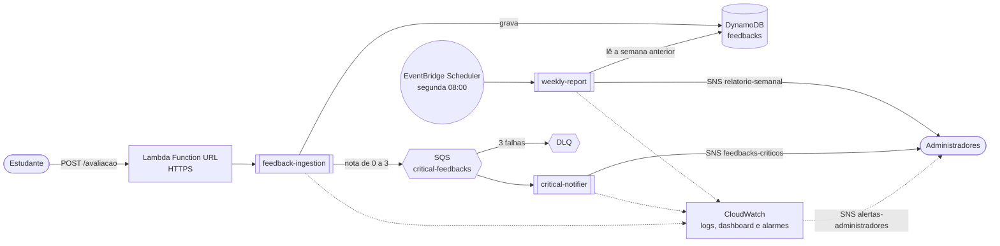
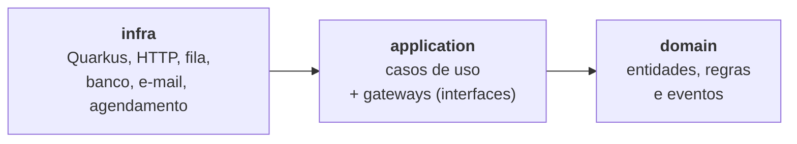

# 12ADJT-fase-4 — Plataforma de Feedback Serverless

[](https://github.com/John-Duque/12ADJT-fase-4/actions/workflows/ci.yml) [](https://github.com/John-Duque/12ADJT-fase-4/actions/workflows/infra.yml) [](https://github.com/John-Duque/12ADJT-fase-4/actions/workflows/docker.yml) [](https://sonarcloud.io/summary/new_code?id=John-Duque_12ADJT-fase-4) [](https://sonarcloud.io/summary/new_code?id=John-Duque_12ADJT-fase-4)

Plataforma em que **estudantes avaliam as aulas** de um curso on-line e **administradores acompanham a satisfação**: avaliações críticas geram um alerta imediato por e-mail e, toda semana, um relatório consolidado chega aos administradores.

Projeto do **Tech Challenge – Fase 4 (POS TECH · Arquitetura e Desenvolvimento Java)**, com foco em Cloud Computing, Serverless e deploy em nuvem.

> **Status:** no ar na AWS (`us-east-2`), com deploy automatizado, monitoramento e alarmes. As três funções foram testadas de ponta a ponta na nuvem ([evidências](docs/evidencias/teste-ponta-a-ponta.md)).

## Sumário

- [A proposta](#a-proposta)
- [Como a solução funciona](#como-a-solução-funciona)
- [Funções serverless](#funções-serverless)
- [Contratos e regras de negócio](#contratos-e-regras-de-negócio)
- [Tecnologias](#tecnologias)
- [Arquitetura](#arquitetura)
- [Estrutura do repositório](#estrutura-do-repositório)
- [Roadmap](#roadmap)
- [Como rodar](#como-rodar)
  - [Como testar localmente](#como-testar-localmente)
  - [Na nuvem (AWS)](#na-nuvem-aws)
- [Qualidade e automação](#qualidade-e-automação)
- [Fluxo de trabalho](#fluxo-de-trabalho)
- [Documentação](#documentação)
- [Grupo](#grupo)

---

## A proposta

### Problema

Para garantir a qualidade de cursos on-line, os estudantes precisam conseguir avaliar as aulas e os administradores precisam acompanhar rapidamente essas avaliações — principalmente as negativas.

### Objetivo

Uma aplicação hospedada em nuvem, com **funções serverless** que automatizam:

1. o **recebimento** das avaliações;
2. o **envio de notificações** quando uma avaliação é crítica;
3. a **geração de relatórios** periódicos.

### Requisitos do Tech Challenge

| Requisito | Como foi atendido |
|---|---|
| Implementar serverless (obrigatório) | Três funções em Quarkus publicadas no AWS Lambda (Java 21, SnapStart) ([funções](docs/funcoes.md)) |
| Rodar em ambiente cloud (obrigatório) | AWS, região `us-east-2` ([ADR 0002](docs/adr/0002-provedor-de-nuvem.md) e [ADR 0004](docs/adr/0004-conta-aws-simplificada.md)) |
| No mínimo duas funções, com responsabilidade única | Três funções, cada uma com um único motivo para mudar e um gatilho próprio: Function URL, fila SQS e agenda ([arquitetura](docs/arquitetura.md#4-por-que-três-funções-e-uma-fila)) |
| Segurança dos dados e governança de acesso | Papel IAM por função com privilégio mínimo, criptografia em repouso e só HTTPS, nenhum segredo no código, MFA, CI que só assume papéis ([segurança](docs/seguranca.md)) |
| Componentes de suporte (banco etc.) | DynamoDB, SQS com DLQ, SNS para os e-mails e EventBridge Scheduler, todos criados pelo Terraform ([infra](infra/README.md)) |
| Deploy automatizado das funções | GitHub Actions: `plan` em cada PR e `apply` a cada merge na `main` ([deploy](docs/deploy.md)) |
| Aplicação monitorada | Logs com o id do feedback, consultas salvas, dashboard e alarmes no CloudWatch ([monitoramento](docs/monitoramento.md)) |
| Notificações automáticas de problemas críticos | E-mail de urgência para avaliações críticas e 5 alarmes que avisam os administradores por e-mail |
| Relatório semanal com média das avaliações | Função agendada toda segunda às 08:00 (São Paulo) que consolida a semana anterior |

### Entregáveis

- Repositório público com o código-fonte e a documentação.
- Vídeo de demonstração com a aplicação funcionando, as funções ativas e as configurações da nuvem.

---

## Como a solução funciona



1. O estudante envia a avaliação (`POST /avaliacao`) com uma descrição e uma nota de 0 a 10.
2. A função **feedback-ingestion** valida, classifica a urgência pela nota e grava no banco.
3. Se a avaliação for **crítica**, ela publica um evento numa fila.
4. A função **critical-notifier** consome a fila e envia o **e-mail de urgência** aos administradores.
5. Toda segunda-feira, a função **weekly-report** lê as avaliações da semana anterior e envia o **relatório** com contagens e média.
6. O CloudWatch acompanha as três funções e avisa os administradores por e-mail quando algo falha.

A fila entre o recebimento e a notificação desacopla as duas funções: se o envio de e-mail falhar, o recebimento de avaliações continua funcionando, a mensagem é tentada de novo e, depois de 3 falhas, vai para a DLQ (com alarme).

Detalhes, diagramas de sequência e o porquê de cada serviço em [`docs/arquitetura.md`](docs/arquitetura.md).

---

## Funções serverless

| Função | Responsabilidade única | Gatilho na AWS | Entrada | Saída |
|---|---|---|---|---|
| [`feedback-ingestion`](functions/feedback-ingestion/README.md) | Receber, validar e gravar a avaliação; publicar as críticas | Function URL: `POST /avaliacao` | JSON da avaliação | Item no DynamoDB; evento na fila (se crítica); resposta `201` |
| [`critical-notifier`](functions/critical-notifier/README.md) | Avisar os administradores sobre avaliações críticas | Mensagem na fila SQS `critical-feedbacks` | `CriticalFeedbackEvent` | E-mail de urgência (SNS) |
| [`weekly-report`](functions/weekly-report/README.md) | Consolidar a semana e enviar o relatório | EventBridge Scheduler, segunda às 08:00 (São Paulo) | — | E-mail com o relatório (SNS) |

Cada função tem **um motivo para mudar**: o contrato da API, o canal de notificação ou as métricas do relatório. É essa separação que o Tech Challenge avalia.

Cada uma tem o próprio README, com contrato, exemplos de requisição, como rodar, como testar, recursos e permissões na AWS: [feedback-ingestion](functions/feedback-ingestion/README.md), [critical-notifier](functions/critical-notifier/README.md) e [weekly-report](functions/weekly-report/README.md). A visão geral e os contratos entre elas estão em [`docs/funcoes.md`](docs/funcoes.md).

---

## Contratos e regras de negócio

### `POST /avaliacao`

Requisição:

```json
{
  "descricao": "A aula ficou sem áudio a partir dos 10 minutos",
  "nota": 2
}
```

Respostas:

| Status | Quando | Corpo |
|---|---|---|
| `201 Created` | Avaliação aceita | `{"id": "8f14e45f-…", "urgencia": "HIGH", "dataEnvio": "2026-10-13T12:00:00Z"}` |
| `400 Bad Request` | Descrição vazia ou com mais de 1000 caracteres; nota ausente ou fora de 0–10 | Mensagem de erro em português |

### Classificação de urgência

| Nota | Urgência | Gera alerta? |
|---|---|---|
| 0 a 3 | `HIGH` | Sim |
| 4 a 6 | `MEDIUM` | Não |
| 7 a 10 | `LOW` | Não |

### E-mail de urgência

Contém **descrição**, **urgência** e **data de envio** da avaliação.

### Relatório semanal

- Período: os **7 dias completos** anteriores à execução, no fuso `America/Sao_Paulo`. Como roda na segunda, cobre de segunda a domingo da semana anterior.
- Conteúdo: lista das avaliações (**descrição, urgência, data de envio**), **quantidade de avaliações por dia**, **quantidade por urgência** e **média das notas**.

---

## Tecnologias

| Tecnologia | Uso | Por quê |
|---|---|---|
| **Java 21** | Linguagem | Versão LTS, records e recursos modernos |
| **Quarkus 3.40** | Framework das funções | Inicialização rápida (menor *cold start*) e extensões prontas para o AWS Lambda |
| **Quarkus REST** | `feedback-ingestion` | Endpoint HTTP com validação (Hibernate Validator) e JSON (Jackson); na AWS, `quarkus-amazon-lambda-http` atrás da Function URL |
| **Quarkus Funqy** | `critical-notifier` e `weekly-report` | A mesma função roda localmente via HTTP e na AWS acionada pela fila ou pela agenda (`quarkus-funqy-amazon-lambda`) |
| **AWS SDK v2** | Gateways reais | DynamoDB, SQS e SNS com o cliente HTTP mais leve (`url-connection-client`) |
| **Maven** (multi-módulo) | Build | Um POM pai com versões centralizadas e um módulo por função |
| **JUnit 5, AssertJ, RestAssured** | Testes | Testes unitários das regras e testes de integração das funções (`@QuarkusTest`) |
| **JaCoCo** | Cobertura | Relatório de cobertura enviado ao Sonar |
| **SonarQube Cloud** | Qualidade | Bugs, vulnerabilidades, duplicação e cobertura em cada PR |
| **GitHub Actions** | CI/CD | Build, testes, análise, imagens Docker e deploy |
| **Docker** | Containers | Imagem multi-stage por função e execução local com Compose |
| **AWS** | Nuvem | Lambda (Function URL e SnapStart), DynamoDB, SQS, SNS, EventBridge Scheduler, CloudWatch e IAM, só no nível sempre gratuito (ADR 0002) |
| **Terraform** | Infraestrutura como código | State no HCP Terraform (plano gratuito), `plan` nos PRs e `apply` pelo GitHub Actions com papéis IAM de credenciais temporárias (ADRs 0003 e 0004) |
| **GHCR** | Imagens Docker | Uma imagem por função, publicada pelo workflow Docker (`ghcr.io/john-duque/12adjt-fase-4/<função>`) |

---

## Arquitetura

### Clean Architecture

Todas as funções seguem a mesma organização em três camadas, no pacote `br.com.fiap.feedback`:



| Camada | Contém | Pode depender de |
|---|---|---|
| `domain` | Entidades (`Feedback`, `WeeklyReport`), regras (`Urgency`), eventos (`CriticalFeedbackEvent`) e exceções de negócio | Nada além do Java |
| `application` | Casos de uso (`ReceiveFeedbackUseCase`, `NotifyCriticalFeedbackUseCase`, `GenerateWeeklyReportUseCase`) e as interfaces **gateway** para o mundo externo | Apenas `domain` |
| `infra` | Controllers e DTOs, consumidor da fila, gatilho agendado, implementações dos gateways (banco, fila, e-mail), configuração CDI e tratamento de erros | `application` e `domain` |

Consequências práticas:

- As regras de negócio são testadas com JUnit puro, sem subir o Quarkus.
- Trocar o provedor de nuvem muda só a camada `infra` e as extensões do `pom.xml`.
- Cada gateway tem duas implementações na `infra`: a provisória (memória e log, `@DefaultBean`), usada no build padrão (dev mode, Docker e testes), e a real da AWS (DynamoDB, SQS e SNS), que entra só no build `mvn package -Plambda`. Os casos de uso são os mesmos nos dois.

Modelo de cloud, componentes, diagramas de sequência e limites conhecidos: [`docs/arquitetura.md`](docs/arquitetura.md).

### Decisões de arquitetura

Registradas como ADRs em [`docs/adr`](docs/adr):

| ADR | Decisão |
|---|---|
| 0001 | Monorepo Maven, Quarkus e Clean Architecture |
| 0002 | Provedor de nuvem: AWS |
| 0003 | Infraestrutura como código: Terraform |
| 0004 | Conta AWS no cadastro simplificado: região `us-east-2` e CI sem OIDC |

---

## Estrutura do repositório

```
12ADJT-fase-4/
├── pom.xml                              # POM pai: Java 21, BOMs do Quarkus e do AWS SDK, JaCoCo, Sonar
├── shared/
│   └── feedback-domain/                 # camada domain compartilhada (Java puro)
│       └── br/com/fiap/feedback/domain/
│           ├── feedback/                #   Feedback, Urgency, InvalidFeedbackException
│           │   └── event/               #   CriticalFeedbackEvent
│           └── shared/exception/        #   DomainException
├── functions/
│   ├── feedback-ingestion/              # Quarkus REST — POST /avaliacao
│   │   └── br/com/fiap/feedback/
│   │       ├── application/feedback/    #   ReceiveFeedbackUseCase + gateway/
│   │       └── infra/                   #   web/, persistence/ (DynamoDB), messaging/ (SQS), config/, shared/exception/
│   ├── critical-notifier/               # Quarkus Funqy — e-mail de urgência
│   │   └── br/com/fiap/feedback/
│   │       ├── application/notification/
│   │       └── infra/                   #   messaging/ (consumidor da fila), notification/ (SNS), config/
│   └── weekly-report/                   # Quarkus Funqy — relatório semanal
│       └── br/com/fiap/feedback/
│           ├── domain/report/           #   WeeklyReport
│           ├── application/report/
│           └── infra/                   #   scheduling/, persistence/ (DynamoDB), notification/ (SNS), config/
├── Dockerfile                           # multi-stage único para as três funções
├── compose.yaml                         # sobe as três funções localmente
├── Makefile                             # atalhos de build, testes e Docker
├── infra/                               # Terraform
│   ├── modules/                         #   function, table, queue, notification, schedule, monitoring
│   └── envs/dev/                        #   ambiente na AWS (us-east-2)
├── docs/
│   ├── arquitetura.md                   # modelo de cloud, componentes e fluxos
│   ├── funcoes.md                       # visão geral das funções e contratos entre elas
│   ├── deploy.md                        # como publicar, validar e destruir
│   ├── monitoramento.md                 # logs, dashboard e alarmes
│   ├── seguranca.md                     # segurança dos dados e governança de acesso
│   ├── evidencias/                      # teste ponta a ponta na AWS, com prints
│   ├── adr/                             # decisões de arquitetura
│   ├── postman/                         # coleção com os testes locais
│   ├── img/                             # prints usados nos documentos
│   └── guia-github.md                   # configuração do GitHub, Sonar e Project
├── .github/
│   ├── workflows/ci.yml                 # build, testes e Sonar
│   ├── workflows/pr-conventions.yml     # nome da branch e título do PR
│   ├── workflows/docker.yml             # imagens e publicação no GHCR
│   ├── workflows/infra.yml              # Terraform: plan nos PRs, apply na main
│   ├── ISSUE_TEMPLATE/                  # templates de task e bug
│   ├── pull_request_template.md
│   └── dependabot.yml
├── CONTRIBUTING.md
└── README.md
```

Portas locais: `feedback-ingestion` **8081**, `critical-notifier` **8082**, `weekly-report` **8083**.

---

## Roadmap

O trabalho está dividido em 10 milestones e 54 tasks numeradas (T01 a T54) no GitHub Project, visualizado como Board. Cada task diz de quais outras depende, é feita numa branch própria e tem um passo a passo em que cada passo é um commit.

| Milestone | Entrega | Status |
|---|---|---|
| 1. Fundação | Sonar, Project, grupo e ADRs | ✅ concluída |
| 2. Domínio | Módulo `feedback-domain`: exceções, `Urgency`, `Feedback`, evento crítico | ✅ concluída |
| 3. Função feedback-ingestion | `POST /avaliacao` com validação e tratamento de erros | ✅ concluída |
| 4. Função critical-notifier | Consumo do evento e e-mail de urgência | ✅ concluída |
| 5. Função weekly-report | Agregações e relatório semanal | ✅ concluída |
| 6. Docker | Dockerfile multi-stage, Compose, imagens no CI e no GHCR, testes locais | ✅ concluída |
| 7. Infraestrutura cloud | Conta, IaC, banco, fila, e-mail e segurança | ✅ concluída |
| 8. Integração com a nuvem | Extensões do provedor e gateways reais | ✅ concluída |
| 9. Deploy e observabilidade | Deploy automatizado, monitoramento e alarmes | ✅ concluída |
| 10. Documentação e entrega | Documentos, vídeo e checklist final | 🔄 documentação concluída; vídeo e checklist final em andamento |

---

## Como rodar

### Pré-requisitos

- JDK 21
- Maven 3.9+
- Docker (para rodar com containers)

### Build e testes

```bash
mvn verify
```

Executa build, testes e cobertura de todos os módulos.

### Funções em modo de desenvolvimento

```bash
mvn install -DskipTests                                     # instala o feedback-domain no Maven local
cd functions/feedback-ingestion && mvn quarkus:dev          # http://localhost:8081
```

```bash
curl -i -X POST localhost:8081/avaliacao -H 'Content-Type: application/json' -d '{"descricao": "Aula sem áudio", "nota": 2}'
```

### Com Docker

Um único `Dockerfile` multi-stage gera a imagem de cada função (escolhida por `--build-arg MODULE`), e o `compose.yaml` sobe as três juntas:

```bash
docker compose up --build -d     # sobe as três funções (8081, 8082 e 8083)
docker compose ps                # cada serviço deve aparecer como healthy
make smoke                       # chama /avaliacao, /notify-critical-feedback e /generate-weekly-report
docker compose down
```

Para uma função só:

```bash
docker compose up --build -d feedback-ingestion                       # sobe só o serviço escolhido
docker build --target test --build-arg MODULE=feedback-ingestion .    # roda os testes dela dentro do Docker
```

`make` sem argumentos lista os outros atalhos (`verify`, `dev-ingestion`, `docker-test`, `logs`, `clean`…).

### Como testar localmente

**1. Subir as funções**

```bash
make up      # sobe as três funções com o compose (8081, 8082 e 8083)
make ps      # os três serviços devem aparecer como healthy
```

Para uma função só em modo dev: `make dev-ingestion`, `make dev-notifier` ou `make dev-report`.

**2. Testar com `curl`**

Cada comando em **uma linha só**: ao colar um comando quebrado com `\`, um espaço depois da `\` separa o comando em dois no zsh.

```bash
curl -i -X POST localhost:8081/avaliacao -H 'Content-Type: application/json' -d '{"descricao":"Aula sem áudio","nota":2}'
curl -i -X POST localhost:8082/notify-critical-feedback -H 'Content-Type: application/json' -d '{"id":"8f14e45f-ceea-467a-9b8e-6c2a9b8f1a11","description":"Aula sem áudio","rating":1,"urgency":"HIGH","createdAt":"2026-10-13T12:00:00Z"}'
curl -i -X POST localhost:8083/generate-weekly-report
```

| Caso | Esperado |
|---|---|
| `POST /avaliacao` com nota 9 / 5 / 2 | `201` com `urgencia` `LOW` / `MEDIUM` / `HIGH`, `id` e `dataEnvio` |
| Nota 11 ou -1, sem `descricao`, `descricao` em branco, sem `nota`, sem corpo | `400` com a mensagem da validação |
| Evento `HIGH` / `LOW` no notifier | `200` com `notified` `true` / `false` |
| Relatório | `200` com o período, `totalFeedbacks = 0` e os 7 dias em `countByDay` |
| `GET /q/health/ready` nas três portas | `200` com `status = UP` |

O `curl` de cada caso, com a resposta completa, está no README da função: [feedback-ingestion](functions/feedback-ingestion/README.md), [critical-notifier](functions/critical-notifier/README.md) e [weekly-report](functions/weekly-report/README.md).

**3. Testar com Postman**

A coleção [`docs/postman/12adjt-fase-4.postman_collection.json`](docs/postman/12adjt-fase-4.postman_collection.json) tem uma pasta por função com todos os casos da tabela (15 requisições), e cada requisição confere o status e os campos da resposta.

1. No Postman: **Import** → selecione o arquivo da coleção.
2. Abra a coleção → **Run** (*Collection Runner*) → **Run 12ADJT-fase-4**.

As URLs ficam nas variáveis da coleção (`ingestionUrl`, `notifierUrl`, `reportUrl`). Sem o Postman instalado, rode pelo terminal:

```bash
npx newman run docs/postman/12adjt-fase-4.postman_collection.json
```

**4. O que aparece nos logs** (`make logs`)

```
Feedback crítico publicado: id=... urgencia=HIGH
[ALERTA] urgencia=HIGH dataEnvio=2026-10-13T12:00:00Z descricao=Aula sem áudio
Evento ignorado: feedback 3c6e0b8a-... não é crítico (urgencia=LOW)
Relatório 2026-10-19 a 2026-10-25: total=0 media=0.00 porUrgencia={HIGH=0, MEDIUM=0, LOW=0}
```

**5. O que dá para testar localmente e o que só dá na nuvem**

Localmente, as funções usam os gateways provisórios (memória e log), sem precisar de conta na AWS.

| Dá para testar localmente | Só na nuvem ([abaixo](#na-nuvem-aws)) |
|---|---|
| Contrato e validações do `POST /avaliacao` | Integração entre as funções: localmente cada container tem os próprios dados e a fila é só um log, então o notifier é chamado direto, simulando a mensagem |
| Classificação de urgência pela nota | Relatório com dados: o gateway provisório devolve uma lista vazia |
| Alerta do notifier (no log) | E-mail real aos administradores |
| Período e estrutura do relatório | DLQ, agenda semanal, dashboard e alarmes |
| Health checks, imagens Docker e o smoke test do workflow | Publicação no GHCR (só no `push` do GitHub Actions) |

Um evento inválido no notifier (descrição em branco ou urgência que não bate com a nota) responde **500** localmente. Na AWS, a mensagem volta para a fila e, depois de 3 tentativas, vai para a DLQ.

**6. Validar o workflow Docker localmente**

```bash
docker run --rm -v "$PWD:/repo" -w /repo rhysd/actionlint:latest    # sintaxe do workflow; sem saída = sem erros
```

O mesmo build e smoke test do job `Imagem <função>`, para as três funções:

```bash
for entry in feedback-ingestion:8081 critical-notifier:8082 weekly-report:8083; do
  module=${entry%%:*}; port=${entry##*:}
  docker build --target runtime --build-arg MODULE=$module --build-arg PORT=$port -t teste/$module . || break
  docker rm -f smoke >/dev/null 2>&1
  docker run -d --name smoke -p "$port:$port" teste/$module >/dev/null
  ok=0
  for attempt in $(seq 1 30); do
    curl -fsS "localhost:$port/q/health/ready" >/dev/null 2>&1 && { echo "✅ $module pronta"; ok=1; break; }
    sleep 2
  done
  [ $ok = 1 ] || { echo "❌ $module não ficou pronta"; docker logs smoke; }
  docker rm -f smoke >/dev/null
done
```

Rode da raiz do repositório (onde está o `Dockerfile`) e com `make down` antes, para as portas estarem livres.

### Na nuvem (AWS)

O deploy é automático: cada merge na `main` empacota as funções (`mvn package -Plambda`) e aplica o Terraform pelo GitHub Actions. Como montar o ambiente do zero, publicar, voltar uma versão e destruir os recursos: [`docs/deploy.md`](docs/deploy.md).

Para testar, pegue o endereço da ingestão no CloudShell (ou no resumo da última execução do workflow **Infra**) e rode cada comando em uma linha só:

```bash
URL=$(aws lambda get-function-url-config --function-name feedback-ingestion --qualifier live --query FunctionUrl --output text)
curl -i "${URL}q/health/ready"
curl -i -X POST "${URL}avaliacao" -H 'Content-Type: application/json' -d '{"descricao":"Aula sem áudio","nota":2}'
aws lambda invoke --function-name weekly-report --qualifier live --cli-binary-format raw-in-base64-out --payload '{}' /tmp/relatorio.json && cat /tmp/relatorio.json
```

| Caso | Esperado |
|---|---|
| Health check | `200` com `status = UP` |
| Nota 2 | `201` com `urgencia = HIGH` e, em poucos segundos, o e-mail de urgência |
| Nota 9 ou 5 | `201` com `LOW` ou `MEDIUM`, sem e-mail |
| Nota 11 | `400` com a mensagem da validação |
| Relatório | JSON da semana anterior e o e-mail do relatório |

O resultado desses testes, com prints das respostas, dos e-mails, da DLQ e do relatório, está em [`docs/evidencias/teste-ponta-a-ponta.md`](docs/evidencias/teste-ponta-a-ponta.md). Para acompanhar uma avaliação nos logs, no dashboard e nos alarmes, veja [`docs/monitoramento.md`](docs/monitoramento.md).

---

## Qualidade e automação

| Automação | Quando roda | O que faz |
|---|---|---|
| **CI** (`ci.yml`) | Push e PR em `main` e `develop` | Build, testes, cobertura JaCoCo e análise no SonarQube Cloud |
| **Convenções do PR** (`pr-conventions.yml`) | Todo PR | Valida o nome da branch e o título em Conventional Commits |
| **Docker** (`docker.yml`) | Push e PR em `main` e `develop` | Gera a imagem de cada função, sobe o container e testa o health check; no push, publica no GHCR |
| **Infra** (`infra.yml`) | PR que altera infra, funções ou POM; push na `main`; manual | `terraform plan` nos PRs (papel só de leitura); na `main`, empacota as funções, aplica o Terraform e testa a URL ([deploy](docs/deploy.md)) |
| **Dependabot** | Semanal/mensal | PRs de atualização de dependências Maven e de Actions |
| **Rulesets** | Sempre | `main` e `develop` só recebem código por PR, com checks verdes e conversas resolvidas; 0 aprovações obrigatórias, porque o grupo tem um integrante |

O quality gate do Sonar exige no código novo: cobertura mínima de 80%, nenhum bug ou vulnerabilidade novos e duplicação de até 3%.

---

## Fluxo de trabalho

```
feature/* ──squash──▶ develop ──merge commit──▶ main
```

1. No Board do Project, pegar a task de menor número (T01…T54) na coluna **Todo** cujas dependências já estejam em **Done**, e mover para **In Progress**.
2. Criar a branch a partir da `develop`: `<tipo>/<issue>-<descricao>` (ex.: `feature/9-urgency`).
3. Fazer os commits do passo a passo da issue, um de cada vez, em Conventional Commits.
4. Abrir o PR para `develop` com `Closes #<issue>` → checks verdes → *Squash and merge* (com mais integrantes, 1 aprovação de outra pessoa).
5. Promover `develop` → `main` com *merge commit* ao fim de cada milestone ou quando uma mudança precisa ir para a nuvem: o merge na `main` dispara o deploy.

Detalhes em [CONTRIBUTING.md](CONTRIBUTING.md) e em [docs/guia-github.md](docs/guia-github.md).

---

## Documentação

| Documento | Conteúdo | Status |
|---|---|---|
| [CONTRIBUTING.md](CONTRIBUTING.md) | Branches, commits, PR e regras de código | ✅ |
| [docs/guia-github.md](docs/guia-github.md) | GitHub, rulesets, Sonar, Project e rotina do grupo | ✅ |
| [docs/adr](docs/adr) | Decisões de arquitetura | ✅ |
| [docs/postman](docs/postman) | Coleção do Postman com os testes locais das funções | ✅ |
| [infra/README.md](infra/README.md) | Módulos e recursos do Terraform, pipeline e comandos | ✅ |
| READMEs das funções | Contrato, como rodar e testar, recursos e permissões na AWS: [ingestion](functions/feedback-ingestion/README.md), [notifier](functions/critical-notifier/README.md), [report](functions/weekly-report/README.md) | ✅ |
| [docs/arquitetura.md](docs/arquitetura.md) | Modelo de cloud, componentes, fluxos e camadas | ✅ |
| [docs/funcoes.md](docs/funcoes.md) | Visão geral das funções, contratos entre elas e regra de urgência | ✅ |
| [docs/deploy.md](docs/deploy.md) | Pré-requisitos, provisionamento, publicação, validação e remoção | ✅ |
| [docs/monitoramento.md](docs/monitoramento.md) | Logs, consultas, dashboard e alarmes do CloudWatch | ✅ |
| [docs/seguranca.md](docs/seguranca.md) | Segurança dos dados e governança de acesso | ✅ |
| [docs/evidencias](docs/evidencias/teste-ponta-a-ponta.md) | Teste ponta a ponta na AWS, com prints | ✅ |
| Vídeo de demonstração | Aplicação funcionando na nuvem | ⏳ |

---

## Grupo

| Nome | RM | GitHub |
|---|---|---|
| John Pablo da Silva Gomes | RM372387 | [@John-Duque](https://github.com/John-Duque) |
