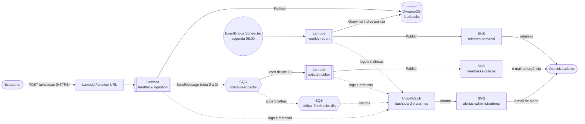
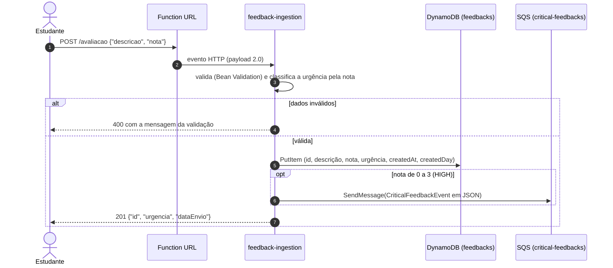
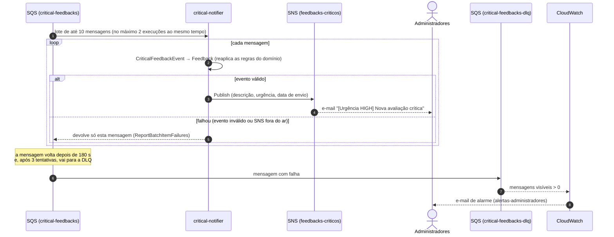
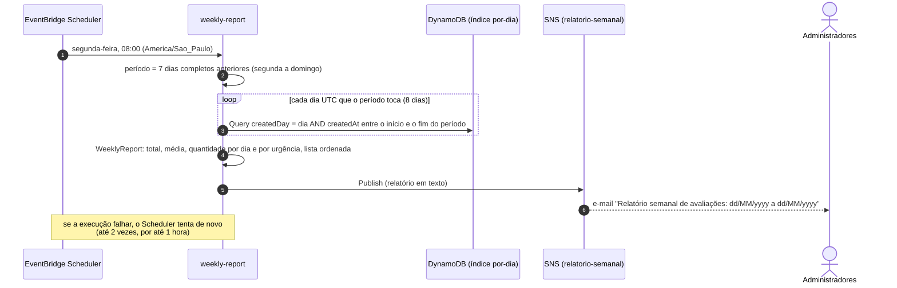
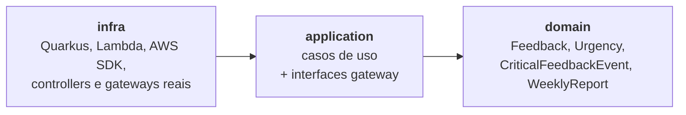

# Arquitetura e modelo de cloud

Como a plataforma de feedback roda na AWS: o modelo de cloud escolhido, o serviço que atende cada componente (com o limite gratuito), os três fluxos passo a passo, por que são três funções ligadas por uma fila e como o código de cada função é organizado.

Decisões relacionadas: [ADR 0001](adr/0001-monorepo-quarkus-clean-architecture.md) (monorepo, Quarkus e Clean Architecture), [ADR 0002](adr/0002-provedor-de-nuvem.md) (AWS e serviços sempre gratuitos), [ADR 0003](adr/0003-infraestrutura-como-codigo.md) (Terraform) e [ADR 0004](adr/0004-conta-aws-simplificada.md) (conta simplificada, região `us-east-2`).

## 1. Modelo de cloud

**Serverless (FaaS) com serviços gerenciados.** As três funções rodam no AWS Lambda e todo o resto (banco, fila, e-mail, agendamento e monitoramento) é serviço gerenciado da AWS. Nenhum servidor, container ou rede é administrado pelo projeto.

| Por quê | Como aparece no projeto |
|---|---|
| É o que o Tech Challenge pede: funções serverless em nuvem, com responsabilidade única | Três funções Lambda, uma por responsabilidade |
| Custo zero: paga-se por uso, e o uso de um projeto acadêmico cabe no nível sempre gratuito | Só serviços sempre gratuitos (tabela da seção 2); sem nada ligado 24 horas |
| Escala sozinho e para em zero | A Lambda só executa quando chega uma avaliação, uma mensagem ou a agenda dispara |
| Menos superfície de ataque e menos operação | Sem servidor para atualizar; criptografia, disponibilidade e backups de infraestrutura ficam com a AWS |
| Componentes nativos e integrados | Fila com DLQ, e-mail, agendador e alarmes na mesma conta, com permissões IAM entre eles |

Toda a infraestrutura é descrita em Terraform ([`infra/`](../infra/README.md)) e criada pelo GitHub Actions na promoção para a `main`. A região é `us-east-2` (Ohio), fixa na conta simplificada.

## 2. Componentes e serviços

| Componente | Serviço AWS | Configuração | Limite sempre gratuito |
|---|---|---|---|
| Entrada `POST /avaliacao` | **Lambda Function URL** | HTTPS, sem autenticação (o endpoint é público), no alias `live` | Sem custo além da invocação da Lambda |
| Funções | **Lambda** (Java 21) | 512 MB; timeouts de 15 s (ingestion), 30 s (notifier) e 60 s (report); SnapStart; alias `live` | 1 milhão de requisições e 400 mil GB-segundo por mês |
| Banco | **DynamoDB** provisionado | Tabela `feedbacks` (partição `id`) e índice `por-dia` (`createdDay` + `createdAt`), 5 RCU / 5 WCU em cada | 25 GB, 25 RCU e 25 WCU (o projeto usa 10/10) |
| Fila de críticos | **SQS** padrão | `critical-feedbacks` com *long polling* de 20 s e visibilidade de 180 s; DLQ `critical-feedbacks-dlq` após 3 tentativas | 1 milhão de requisições por mês (o *long polling* contínuo gasta cerca de 650 mil) |
| E-mails | **SNS** | Tópicos `feedbacks-criticos`, `relatorio-semanal` e `alertas-administradores`, com assinatura por e-mail | 1 milhão de publicações e 1.000 e-mails por mês |
| Agendamento | **EventBridge Scheduler** | `cron(0 8 ? * MON *)` em `America/Sao_Paulo`, até 2 novas tentativas | 14 milhões de invocações por mês |
| Logs | **CloudWatch Logs** | Um grupo por função, retenção de 7 dias, 3 consultas salvas no Logs Insights | 5 GB por mês (inclui o que o Logs Insights lê) |
| Métricas e dashboard | **CloudWatch** | Dashboard `feedback-plataforma` com 26 métricas | 3 dashboards de até 50 métricas |
| Alarmes | **CloudWatch Alarms** | 5 alarmes (erros nas 3 funções, DLQ e *throttles* da ingestão) → SNS | 10 alarmes |
| Permissões | **IAM** | Um papel por função e um para a agenda, todos com prefixo `feedback-` | Sem custo |
| Criptografia | Chaves da AWS e **KMS** | DynamoDB com a chave da própria AWS, SQS com SSE-SQS e os tópicos de e-mail com a chave gerenciada `alias/aws/sns` | Chave gerenciada sem mensalidade; 20 mil requisições ao KMS por mês |
| Auditoria | **CloudTrail** (histórico de eventos) | Últimos 90 dias de ações na conta | Sem custo |

Fora da AWS, também sem custo: imagens Docker no GitHub Container Registry (públicas), state do Terraform no HCP Terraform (plano gratuito) e CI/CD no GitHub Actions (repositório público).

**Evitados por gerar custo:** API Gateway e SES (grátis só por 12 meses), DynamoDB *on-demand*, backups e PITR, Secrets Manager, chave KMS própria, trail do CloudTrail, VPC/NAT Gateway, *provisioned concurrency* e bucket S3.

## 3. Fluxos

### 3.1 Recebimento de uma avaliação

A resposta não espera o e-mail: a ingestão só grava e, se a avaliação for crítica, deixa o evento na fila.

### 3.2 Notificação de uma avaliação crítica

### 3.3 Relatório semanal

O período é calculado no fuso de São Paulo, mas os dados ficam em UTC. Por isso a consulta passa por 8 dias UTC e corta as bordas pelo horário exato.

## 4. Por que três funções e uma fila

**Três funções, uma responsabilidade cada.** Cada uma tem um motivo diferente para mudar:

| Função | Muda quando muda... |
|---|---|
| `feedback-ingestion` | O contrato da API ou a regra de classificação |
| `critical-notifier` | O canal ou o formato do alerta |
| `weekly-report` | O conteúdo ou a periodicidade do relatório |

A separação também traz vantagens na nuvem:

- **Permissões mínimas por função**: a ingestão só grava na tabela e publica na fila; o notifier só consome a fila e publica no tópico de urgência; o relatório só consulta o índice e publica no tópico do relatório. Uma função comprometida não alcança o que as outras fazem.
- **Configuração própria**: o timeout de cada função combina com o trabalho dela (15 s para responder ao estudante, 60 s para consolidar a semana), assim como o gatilho (HTTP, fila ou agenda).
- **Falhas isoladas**: um erro no e-mail ou no relatório não derruba o recebimento de avaliações.

**A fila entre a ingestão e o notifier.**

- **Resposta rápida**: o estudante recebe o `201` sem esperar o envio do e-mail.
- **Tolerância a falhas**: se o SNS falhar, a avaliação já está gravada e a mensagem continua na fila para nova tentativa. Depois de 3 tentativas, vai para a DLQ, onde fica 14 dias, dispara um alarme e pode ser devolvida à fila.
- **Controle de vazão**: o notifier processa no máximo 2 lotes ao mesmo tempo, então um pico de avaliações críticas não ocupa as execuções simultâneas de que a ingestão precisa.
- **Contrato explícito**: o `CriticalFeedbackEvent` em JSON é o contrato entre as duas funções. O notifier reconstrói o `Feedback` a partir dele e reaplica as regras do domínio, então um evento inválido nunca vira e-mail.

Publicar direto no SNS a partir da ingestão seria mais simples, mas colocaria o envio do e-mail no caminho da requisição. A ingestão também precisaria de permissão no tópico e conheceria o formato do alerta.

## 5. Camadas internas

As três funções seguem a mesma Clean Architecture, no pacote `br.com.fiap.feedback` ([ADR 0001](adr/0001-monorepo-quarkus-clean-architecture.md)):

| Camada | Onde fica | O que contém |
|---|---|---|
| `domain` | `shared/feedback-domain` (Java puro, compartilhado) e `domain/report` no `weekly-report` | Entidades, regra de urgência (0–3 `HIGH`, 4–6 `MEDIUM`, 7–10 `LOW`), evento da fila, relatório |
| `application` | Cada função | `ReceiveFeedbackUseCase`, `NotifyCriticalFeedbackUseCase`, `GenerateWeeklyReportUseCase` e as interfaces gateway; o `Clock` é injetado |
| `infra` | Cada função | Controller REST ou função Funqy, gateways da AWS (`DynamoDb*`, `Sqs*`, `Sns*`), producers CDI e tratamento de erros |

Os gateways de cada função, em cada build:

| Função | Gateway | Build padrão (dev, Docker, testes) | Build `-Plambda` (AWS) |
|---|---|---|---|
| `feedback-ingestion` | `FeedbackGateway` | `InMemoryFeedbackGateway` | `DynamoDbFeedbackGateway` |
| `feedback-ingestion` | `CriticalFeedbackEventGateway` | `LoggingCriticalFeedbackEventGateway` | `SqsCriticalFeedbackEventGateway` |
| `critical-notifier` | `AdminNotificationGateway` | `LoggingAdminNotificationGateway` | `SnsAdminNotificationGateway` |
| `weekly-report` | `FeedbackQueryGateway` | `NoOpFeedbackQueryGateway` | `DynamoDbFeedbackQueryGateway` |
| `weekly-report` | `ReportDeliveryGateway` | `LoggingReportDeliveryGateway` | `SnsReportDeliveryGateway` |

- **Troca no build**: as implementações provisórias são `@DefaultBean`. As da AWS só entram no pacote quando o profile Maven `lambda` liga a propriedade `feedback.aws.enabled` (`@IfBuildProperty`). Nenhum caso de uso muda.
- **Pacote**: o profile `lambda` também troca a ligação com o mundo externo, de servidor HTTP para handler da Lambda (`quarkus-amazon-lambda-http` na ingestão, `quarkus-funqy-amazon-lambda` no notifier e no relatório), e gera o `function.zip` que o Terraform publica.
- **Acesso à AWS**: os gateways usam o AWS SDK v2 direto, com o cliente HTTP do próprio Java (`url-connection-client`). O pacote fica menor, e os testes usam clientes falsos, sem Docker nem AWS.

## 6. Limites conhecidos

- **Execuções simultâneas**: a conta tem limite de 10, e a AWS exige que todas fiquem sem reserva. Por isso não há *reserved concurrency* na ingestão; o próprio limite da conta serve de teto, o excesso recebe `429` e o alarme de *throttles* avisa ([segurança](seguranca.md)).
- **Sem API Gateway**: não há autorizador nem limite por cliente. A proteção do endpoint vem da validação na aplicação e do limite de execuções.
- **Capacidade fixa no DynamoDB**: 5 WCU aguentam cerca de 5 gravações por segundo (itens de até 1 KB) de forma contínua. É suficiente para o volume de avaliações de uma turma, sem custo.
- **Conta simplificada**: sem OIDC nem IAM Access Analyzer, por causa de SCPs da AWS; as alternativas estão no [ADR 0004](adr/0004-conta-aws-simplificada.md) e nas [evidências](evidencias/teste-ponta-a-ponta.md).
