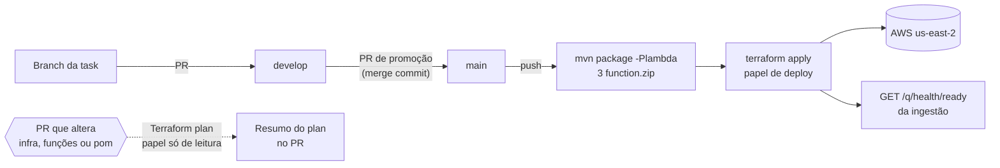

# Deploy

Como publicar a plataforma na AWS do zero, como cada mudança chega à nuvem, como conferir se deu certo e como remover tudo no fim. O deploy é **automatizado**: o Terraform descreve toda a infraestrutura e o GitHub Actions empacota as funções e aplica as mudanças quando o código chega à `main`.

Detalhes de cada recurso no [`infra/README.md`](../infra/README.md); arquitetura em [`arquitetura.md`](arquitetura.md); credenciais e permissões em [`seguranca.md`](seguranca.md).

## Visão geral



| Etapa | Onde | O que acontece |
|---|---|---|
| PR para `develop` ou `main` | Workflow **Infra**, job `Terraform plan` | Formata, empacota as funções, valida e mostra o que mudaria na AWS, com credenciais **só de leitura** |
| Merge na `main` | Workflow **Infra**, job `Terraform apply` (Environment `production`) | Empacota, cria ou atualiza os recursos, publica versões novas das três funções e testa a URL da ingestão |
| Merge na `develop` ou `main` | Workflow **Docker** | Publica as imagens das funções no GHCR (para rodar localmente; a AWS usa os `function.zip`) |

## 1. Pré-requisitos

Feito uma vez, antes do primeiro deploy.

### 1.1 Ferramentas

| Ferramenta | Para quê | Obrigatória? |
|---|---|---|
| Conta AWS | Onde tudo roda (cadastro simplificado, *Free plan*, região `us-east-2`; [ADR 0004](adr/0004-conta-aws-simplificada.md)) | Sim |
| AWS CloudShell | Criar os acessos do CI e testar na nuvem; já vem com o AWS CLI | Sim (no console da AWS) |
| Conta no [HCP Terraform](https://app.terraform.io) | Guardar o state do Terraform (plano gratuito) | Sim |
| Repositório no GitHub com Actions | Rodar o plan e o apply | Sim |
| Java 21 e Maven 3.9 | Empacotar e testar localmente | Só para testar antes do PR |
| Terraform 1.17 | Validar a IaC localmente | Não |

### 1.2 Acessos do CI na AWS

O GitHub Actions usa dois usuários técnicos, sem console, que só podem assumir um papel cada ([por quê](seguranca.md#5-credenciais-do-ci-github-actions)). No **CloudShell**, rode cada bloco de uma vez:

```bash
ACC=$(aws sts get-caller-identity --query Account --output text)
confia() { echo "{\"Version\":\"2012-10-17\",\"Statement\":[{\"Effect\":\"Allow\",\"Principal\":{\"AWS\":\"arn:aws:iam::$ACC:user/$1\"},\"Action\":\"sts:AssumeRole\"}]}"; }
assume() { echo "{\"Version\":\"2012-10-17\",\"Statement\":[{\"Effect\":\"Allow\",\"Action\":\"sts:AssumeRole\",\"Resource\":\"arn:aws:iam::$ACC:role/$1\"}]}"; }
aws iam create-user --user-name ci-terraform-plan
aws iam create-user --user-name ci-deploy
sleep 10
```

```bash
# Plan: papel só de leitura
aws iam create-role --role-name github-terraform-plan --assume-role-policy-document "$(confia ci-terraform-plan)"
aws iam attach-role-policy --role-name github-terraform-plan --policy-arn arn:aws:iam::aws:policy/ReadOnlyAccess
aws iam put-user-policy --user-name ci-terraform-plan --policy-name assumir-github-terraform-plan --policy-document "$(assume github-terraform-plan)"
```

```bash
# Deploy: PowerUserAccess + gestão só dos papéis feedback-*
aws iam create-role --role-name github-deploy --assume-role-policy-document "$(confia ci-deploy)"
aws iam attach-role-policy --role-name github-deploy --policy-arn arn:aws:iam::aws:policy/PowerUserAccess
aws iam put-role-policy --role-name github-deploy --policy-name papeis-feedback --policy-document "{\"Version\":\"2012-10-17\",\"Statement\":[{\"Sid\":\"SoPapeisDoProjeto\",\"Effect\":\"Allow\",\"Action\":[\"iam:CreateRole\",\"iam:DeleteRole\",\"iam:GetRole\",\"iam:UpdateRole\",\"iam:UpdateAssumeRolePolicy\",\"iam:TagRole\",\"iam:UntagRole\",\"iam:ListRoleTags\",\"iam:PutRolePolicy\",\"iam:GetRolePolicy\",\"iam:DeleteRolePolicy\",\"iam:ListRolePolicies\",\"iam:AttachRolePolicy\",\"iam:DetachRolePolicy\",\"iam:ListAttachedRolePolicies\",\"iam:ListInstanceProfilesForRole\",\"iam:PassRole\"],\"Resource\":\"arn:aws:iam::$ACC:role/feedback-*\"}]}"
aws iam put-user-policy --user-name ci-deploy --policy-name assumir-github-deploy --policy-document "$(assume github-deploy)"
```

Depois, crie uma chave para cada usuário e copie os dois valores **direto para os secrets do GitHub** (item 1.4). Não cole a chave em nenhum outro lugar.

```bash
aws iam create-access-key --user-name ci-terraform-plan
aws iam create-access-key --user-name ci-deploy
```

As políticas completas estão em [`seguranca.md`](seguranca.md#políticas).

### 1.3 HCP Terraform

1. Crie uma organização e um workspace do tipo **CLI-driven**. Os nomes têm que ser os do bloco `cloud` em [`infra/envs/dev/versions.tf`](../infra/envs/dev/versions.tf): organização `john-duque-12adjt` e workspace `12adjt-fase-4-dev`. Em outra organização, troque os nomes no arquivo.
2. No workspace, **Settings → General → Execution Mode → Custom → Local**. O HCP só guarda o state e faz o lock; o Terraform roda no GitHub Actions com as credenciais da AWS.
3. **Account settings → Tokens → Create an API token** e guarde o token para o secret `TF_TOKEN_app_terraform_io`.

### 1.4 GitHub

**Settings → Secrets and variables → Actions → New repository secret**:

| Secret | Valor |
|---|---|
| `TF_TOKEN_app_terraform_io` | Token do HCP Terraform |
| `AWS_PLAN_ACCESS_KEY_ID`, `AWS_PLAN_SECRET_ACCESS_KEY` | Chave do `ci-terraform-plan` |
| `ADMIN_EMAILS` | E-mails dos administradores, um apelido para cada: `{"john":"admin@exemplo.com"}` |

**Settings → Environments → New environment** `production`:

- **Deployment branches and tags → Selected branches and tags** → só `main`. Assim, nenhuma outra branch consegue usar a chave de deploy.
- **Environment secrets**: `AWS_DEPLOY_ACCESS_KEY_ID` e `AWS_DEPLOY_SECRET_ACCESS_KEY`, com a chave do `ci-deploy`.

## 2. Empacotar as funções

Cada função vira um `function.zip` com o handler da Lambda e os gateways reais da AWS (profile Maven `lambda`):

```bash
mvn -B -ntp package -Plambda -DskipTests
```

| Função | Pacote | Handler |
|---|---|---|
| `feedback-ingestion` | `functions/feedback-ingestion/target/function.zip` | `io.quarkus.amazon.lambda.runtime.QuarkusStreamHandler::handleRequest` |
| `critical-notifier` | `functions/critical-notifier/target/function.zip` | `io.quarkus.funqy.lambda.FunqyStreamHandler::handleRequest` |
| `weekly-report` | `functions/weekly-report/target/function.zip` | `io.quarkus.funqy.lambda.FunqyStreamHandler::handleRequest` |

O workflow faz isso sozinho antes do plan e do apply. Rodar localmente só serve para conferir antes do PR. Para conferir que o pacote leva os gateways da AWS:

```bash
unzip -l functions/feedback-ingestion/target/feedback-ingestion-*-runner.jar | grep _Bean.class
```

Devem aparecer `DynamoDbFeedbackGateway_Bean` e `SqsCriticalFeedbackEventGateway_Bean`.

## 3. Provisionar e publicar

### 3.1 Automático (o caminho normal)

1. Abra o PR da task para a `develop`. Se ele altera `infra/**`, `functions/**`, `shared/**` ou o `pom.xml`, o job **Terraform plan** mostra no resumo da execução o que mudaria (`Plan: X to add, Y to change, Z to destroy`).
2. Depois do merge na `develop`, abra o PR de promoção `develop` → `main` e faça o merge com **Create a merge commit**.
3. O push na `main` dispara o job **Terraform apply**:
   - empacota as funções;
   - cria ou atualiza os recursos e envia os `function.zip` novos;
   - publica uma versão de cada função e espera o snapshot do SnapStart ficar pronto antes de mover o alias `live` (alguns minutos);
   - testa `GET <url>q/health/ready` da ingestão.
4. O resumo da execução mostra o endereço: `Ingestão: POST <url>avaliacao`.

No **primeiro** deploy, cada administrador recebe um e-mail **AWS Notification - Subscription Confirmation** para cada tópico (`feedbacks-criticos`, `relatorio-semanal` e `alertas-administradores`) e precisa clicar em **Confirm subscription**. Sem isso, nenhum e-mail chega.

### 3.2 Manual

Para aplicar sem um push novo (por exemplo, depois de trocar um secret): GitHub → **Actions → Infra → Run workflow**, branch `main`, ação `apply`. Usa o mesmo job e as mesmas credenciais do automático.

Ninguém tem chave de acesso pessoal da AWS. Para rodar o Terraform fora do GitHub, o caminho é o CloudShell, com os comandos em [`infra/README.md`](../infra/README.md#comandos).

## 4. Validar

No **CloudShell**, pegue o endereço da ingestão:

```bash
URL=$(aws lambda get-function-url-config --function-name feedback-ingestion --qualifier live --query FunctionUrl --output text); echo "$URL"
```

Depois, cada comando em uma linha só:

```bash
curl -i "${URL}q/health/ready"
curl -i -X POST "${URL}avaliacao" -H 'Content-Type: application/json' -d '{"descricao":"Teste de deploy: aula boa","nota":9}'
curl -i -X POST "${URL}avaliacao" -H 'Content-Type: application/json' -d '{"descricao":"Teste de deploy: aula sem áudio","nota":2}'
curl -i -X POST "${URL}avaliacao" -H 'Content-Type: application/json' -d '{"descricao":"Teste de deploy","nota":11}'
aws lambda invoke --function-name weekly-report --qualifier live --cli-binary-format raw-in-base64-out --payload '{}' /tmp/relatorio.json && cat /tmp/relatorio.json
```

| Comando | Esperado |
|---|---|
| Health check | `200` com `"status": "UP"` |
| Nota 9 | `201` com `"urgencia":"LOW"`; item novo na tabela `feedbacks`; nenhum e-mail |
| Nota 2 | `201` com `"urgencia":"HIGH"`; e-mail `[Urgência HIGH] Nova avaliação crítica` em poucos segundos |
| Nota 11 | `400` com `A nota deve ser no máximo 10` |
| Relatório | `StatusCode 200`, o JSON da semana anterior e o e-mail `Relatório semanal de avaliações: ...` |

No console, confira também:

- **CloudWatch → Painéis → `feedback-plataforma`**: invocações nas funções e todos os alarmes em OK, exceto se houver mensagens na DLQ.
- **EventBridge → Scheduler → Agendamentos → `feedback-weekly-report`**: estado Habilitado e próxima execução na segunda às 08:00.

O teste completo, com prints, está em [`evidencias/teste-ponta-a-ponta.md`](evidencias/teste-ponta-a-ponta.md).

## 5. Voltar uma versão

Cada deploy publica versões novas e move o alias `live`, mas as versões anteriores continuam na Lambda.

- **Caminho normal**: reverter o commit com problema na `develop` (`git revert`) e promover para a `main`. O apply publica de novo o código anterior.
- **Emergência**, enquanto o revert não chega: apontar o alias para a versão anterior pelo CloudShell. O próximo apply volta o alias para a versão mais nova.

  ```bash
  aws lambda list-versions-by-function --function-name feedback-ingestion --query "Versions[].Version"
  aws lambda update-alias --function-name feedback-ingestion --name live --function-version <versão anterior>
  ```

## 6. Destruir os recursos

O projeto fica no ar até a nota. Depois:

1. GitHub → **Actions → Infra → Run workflow**, branch `main`, ação **`destroy`**. O Terraform remove tudo o que criou: funções, tabela (com os dados), filas, tópicos, agenda, dashboard, alarmes, papéis `feedback-*` e grupos de logs.
2. No CloudShell, remova os acessos do CI, que foram criados à mão. Rode um comando por vez:

   ```bash
   for u in ci-terraform-plan ci-deploy; do for k in $(aws iam list-access-keys --user-name $u --query "AccessKeyMetadata[].AccessKeyId" --output text); do aws iam delete-access-key --user-name $u --access-key-id $k; done; done
   for u in ci-terraform-plan ci-deploy; do for p in $(aws iam list-user-policies --user-name $u --query "PolicyNames[]" --output text); do aws iam delete-user-policy --user-name $u --policy-name $p; done; done
   aws iam delete-user --user-name ci-terraform-plan
   aws iam delete-user --user-name ci-deploy
   aws iam detach-role-policy --role-name github-terraform-plan --policy-arn arn:aws:iam::aws:policy/ReadOnlyAccess
   aws iam delete-role --role-name github-terraform-plan
   aws iam detach-role-policy --role-name github-deploy --policy-arn arn:aws:iam::aws:policy/PowerUserAccess
   aws iam delete-role-policy --role-name github-deploy --policy-name papeis-feedback
   aws iam delete-role --role-name github-deploy
   ```

3. Apague os secrets do repositório e do Environment `production`, o token e o workspace no HCP Terraform e, se quiser, os pacotes do GHCR.

Com o *Free plan* não há cobrança mesmo sem destruir. Remover tudo evita que os recursos e as chaves fiquem esquecidos.

## 7. Problemas comuns

| Sintoma | Causa | O que fazer |
|---|---|---|
| `Credentials could not be loaded` no plan ou no apply | Secret faltando ou com nome errado | Conferir os secrets da seção 1.4 (o Environment `production` só vale para a `main`) |
| `Terraform apply` não roda a partir de outra branch | Regra *Deployment branches* do Environment `production` | É o esperado: o deploy só sai da `main` |
| `504` logo depois de um deploy | A versão nova ainda está criando o snapshot do SnapStart | O apply espera o snapshot antes de mover o alias; se acontecer, aguarde alguns minutos |
| Nenhum e-mail chega | Assinatura do tópico não confirmada | Procurar o e-mail **Subscription Confirmation** (inclusive em spam e promoções) e confirmar |
| `Error acquiring the state lock` | Outro plan ou apply está usando o state | Esperar a outra execução terminar; o workflow já espera até 5 minutos |
| `429` na URL da ingestão | Limite de 10 execuções simultâneas da conta | Esperado em picos; o alarme `feedback-ingestion-throttles` avisa |
