# Teste ponta a ponta na AWS

Evidências de que o fluxo completo funciona na nuvem: avaliação recebida pela Function URL, gravada no DynamoDB, crítica enviada para a fila e para o e-mail, relatório semanal gerado e evento inválido isolado na DLQ.

- **Quando:** 11 a 13/11/2026, depois do primeiro deploy pela promoção para a `main`.
- **Onde:** conta AWS do projeto, região `us-east-2`; as funções rodam pelo alias `live` (versão publicada com SnapStart).
- **Dados ocultos nos prints:** ID da conta, e-mails, nomes e links de cancelamento da assinatura.

## Resumo

| # | Cenário | Esperado | Resultado |
|---|---|---|---|
| 1 | `POST /avaliacao` com nota 2 | Item no DynamoDB, mensagem consumida da fila e e-mail de urgência | ✅ 201 `HIGH`, item gravado, e-mail recebido |
| 2 | `POST /avaliacao` com nota 9 (e nota 5) | Item no DynamoDB, **sem** e-mail | ✅ 201 `LOW`/`MEDIUM`, nenhum e-mail |
| 3 | Dados inválidos (nota 11, sem descrição) | 400 com a mensagem da validação | ✅ 400 |
| 4 | Execução manual do relatório | E-mail com os dados da semana | ✅ relatório de 06/11 a 12/11 com 155 avaliações |
| 5 | Evento inválido na fila | Mensagem na DLQ após 3 tentativas | ✅ mensagens na DLQ com 4 recebimentos |
| 6 | Agendamento semanal | Agenda ativa toda segunda às 08:00 | ✅ próxima execução em 16/11/2026 |
| 7 | Revisão de acesso (IAM) | Um papel por função; analisador de acesso externo | ✅ papéis `feedback-*`; ⚠️ Access Analyzer bloqueado pela conta |

## 1. Avaliação crítica (nota 2)

Chamadas feitas com `curl` na Function URL (`https://<id>.lambda-url.us-east-2.on.aws/`) em 12/11/2026 às 05:05 UTC:

```text
== GET /q/health/ready
{"status": "UP", "checks": []}
HTTP 200

== POST /avaliacao {"descricao":"T41: aula sem áudio nos primeiros 20 minutos","nota":2}
{"id":"2c031b0b-55d6-4e05-9c2c-dc575cb67cf2","urgencia":"HIGH","dataEnvio":"2026-11-12T05:05:12.580034012Z"}
HTTP 201 em 1,0 s
```

Outra avaliação crítica pelo terminal, com os cabeçalhos da resposta:

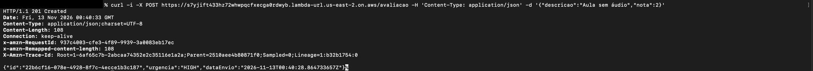

A tabela `feedbacks` (provisionada 5/5, índice `por-dia`) e os itens gravados, entre eles o `2c031b0b…` acima:

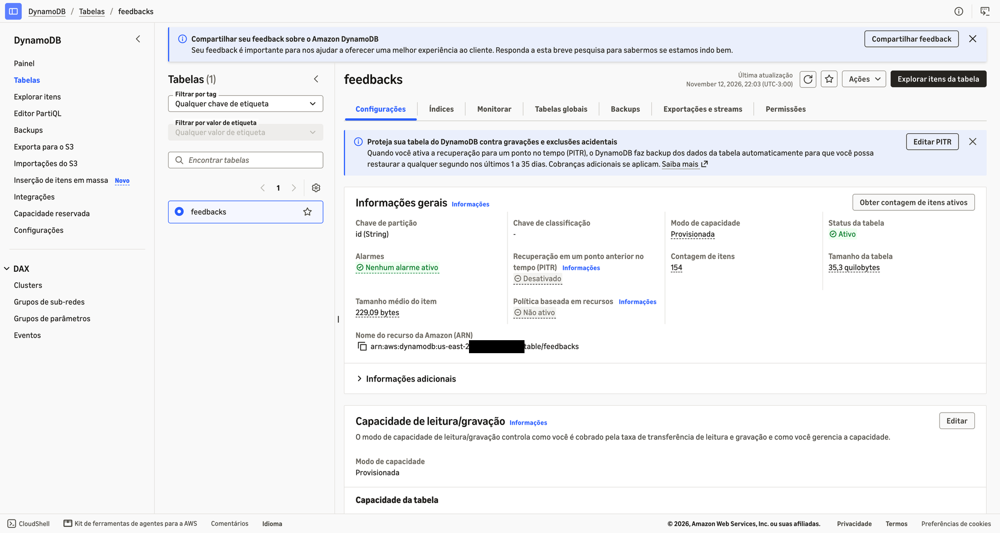

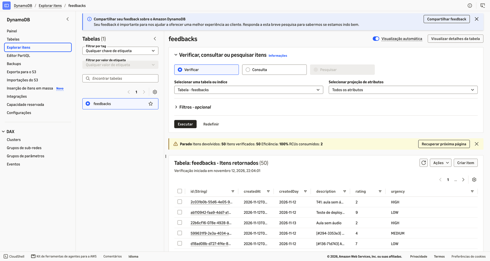

A ingestão publicou o evento na fila `critical-feedbacks`, o `critical-notifier` consumiu a mensagem e publicou no tópico `feedbacks-criticos`. O e-mail chegou com **descrição, urgência e data de envio** (no fuso de São Paulo: 05:05:12 UTC = 02:05:12):

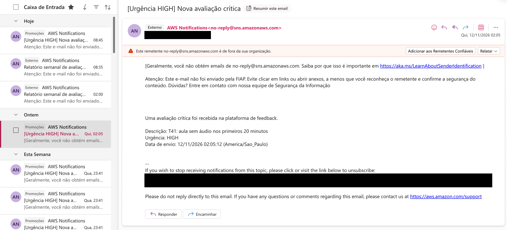

## 2. Avaliações não críticas (notas 9 e 5)

```text
== POST /avaliacao {"descricao":"T41: aula muito boa, exemplos claros","nota":9}
{"id":"d7875094-8a96-400f-9833-0bb0196be311","urgencia":"LOW","dataEnvio":"2026-11-12T05:05:07.062073003Z"}
HTTP 201 em 5,3 s

== POST /avaliacao {"descricao":"T41: aula ok, mas o ritmo foi rápido","nota":5}
{"id":"85d18b82-30a7-451b-8015-ae040fe9f93c","urgencia":"MEDIUM","dataEnvio":"2026-11-12T05:05:12.057970764Z"}
HTTP 201 em 0,5 s
```

As duas foram gravadas (contam no relatório da seção 4), mas não geraram e-mail: na caixa de entrada do print anterior há **um único** e-mail de urgência às 02:05, o da nota 2.

A primeira chamada levou 5,3 s porque a função estava parada: inclui a restauração do snapshot do SnapStart e a criação do cliente do DynamoDB. As seguintes ficaram abaixo de 1 s.

## 3. Dados inválidos

```text
== POST /avaliacao {"descricao":"T41: nota inválida","nota":11}
{"title":"Constraint Violation","status":400,"violations":[{"field":"receive.request.rating","message":"A nota deve ser no máximo 10"}]}
HTTP 400

== POST /avaliacao {"nota":4}
{"title":"Constraint Violation","status":400,"violations":[{"field":"receive.request.description","message":"A descrição é obrigatória"}]}
HTTP 400
```

Nada é gravado nem publicado quando a validação falha.

## 4. Relatório semanal

Execução manual pelo CloudShell em 12/11/2026 (período de 05/11 a 11/11):

```bash
aws lambda invoke --function-name weekly-report --qualifier live --cli-binary-format raw-in-base64-out --payload '{}' /tmp/relatorio.json && cat /tmp/relatorio.json
```

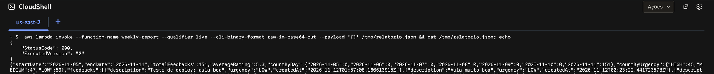

Execução manual pelo console (aba **Testar** do alias `live`) em 13/11/2026, cobrindo os 7 dias completos anteriores (06/11 a 12/11):

```json
{
  "startDate": "2026-11-06",
  "endDate": "2026-11-12",
  "totalFeedbacks": 155,
  "averageRating": 5.28,
  "countByDay": {"2026-11-06": 0, "2026-11-07": 0, "2026-11-08": 0, "2026-11-09": 0, "2026-11-10": 0, "2026-11-11": 151, "2026-11-12": 4},
  "countByUrgency": {"HIGH": 47, "MEDIUM": 48, "LOW": 60}
}
```

Log da execução:

```text
DEBUG [DynamoDbFeedbackQueryGateway] Feedbacks lidos do banco: 155 (de 2026-11-06T03:00:00Z até 2026-11-13T03:00:00Z)
INFO  [SnsReportDeliveryGateway] Relatório semanal enviado: periodo=2026-11-06 a 2026-11-12 total=155 media=5.28
REPORT Duration: 7310.85 ms  Memory Size: 512 MB  Max Memory Used: 186 MB  Restore Duration: 752.07 ms
```

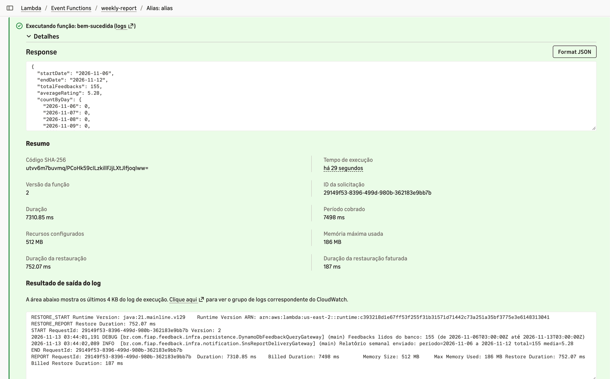

O período é calculado no fuso de São Paulo: a consulta vai de 06/11 00:00 (03:00 UTC) até 13/11 00:00, por isso as avaliações feitas na madrugada de 12/11 em UTC aparecem no dia 11/11.

O e-mail traz todos os campos pedidos: período, total, média, quantidade por urgência, quantidade por dia e a lista com data de envio, urgência e descrição:

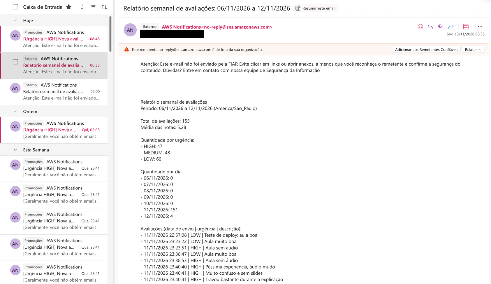

## 5. Evento inválido vai para a DLQ

Pelo console do SQS (**Enviar e receber mensagens** na fila `critical-feedbacks`), foi enviado um evento com a descrição em branco, que o domínio rejeita ao reconstruir o `Feedback`:

```json
{"id":"00000000-0000-4000-8000-000000000041","description":"   ","rating":1,"urgency":"HIGH","createdAt":"2026-11-12T05:00:00Z"}
```

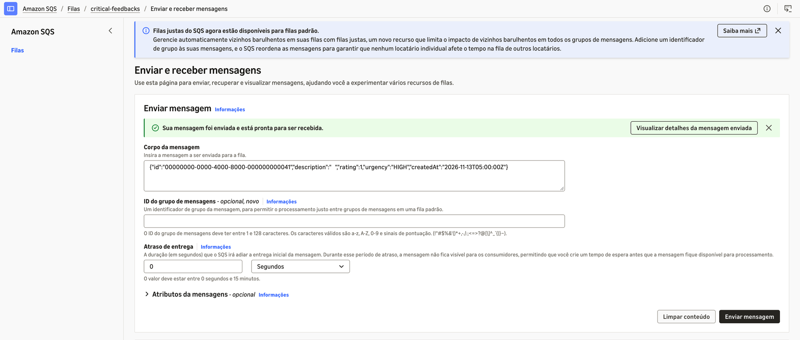

O `critical-notifier` falha ao processar a mensagem e a devolve à fila (`ReportBatchItemFailures`). Depois de 3 tentativas, com 180 s de visibilidade entre elas, o SQS a move para a `critical-feedbacks-dlq` (`maxReceiveCount = 3`). Nenhum e-mail é enviado.

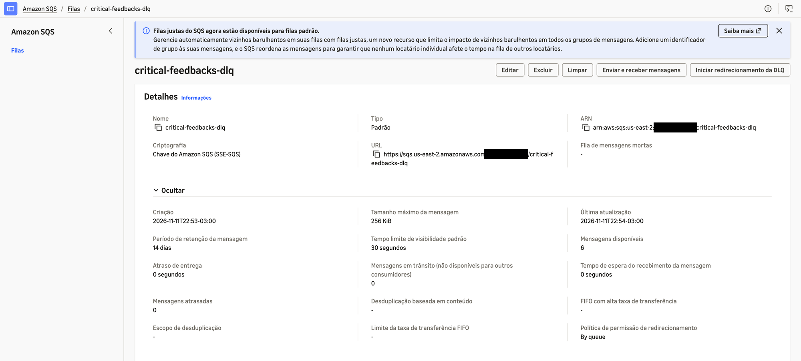

Na DLQ, cada mensagem mantém o corpo original e mostra **4 recebimentos**: as 3 tentativas do notifier e a leitura em que o SQS a moveu:

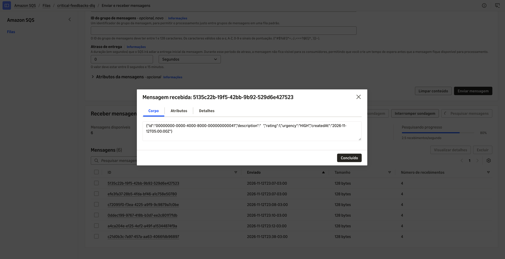

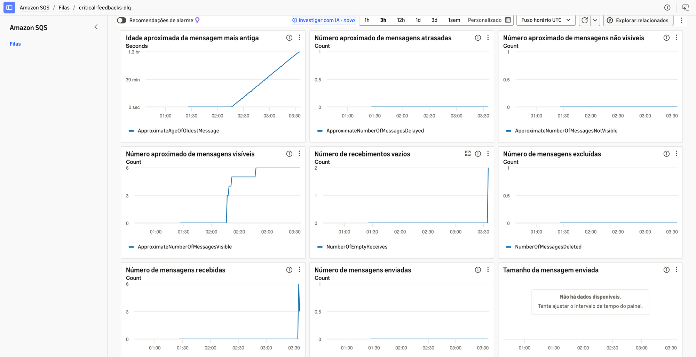

As mensagens ficam 14 dias na DLQ para análise. Depois de corrigir a causa, dá para devolvê-las à fila com **Iniciar redirecionamento da DLQ**.

## 6. Agendamento semanal

A agenda `feedback-weekly-report` do EventBridge Scheduler chama o alias `live` do `weekly-report` toda segunda às 08:00 no fuso de São Paulo (`cron(0 8 ? * MON *)`), com até 2 novas tentativas em caso de falha:

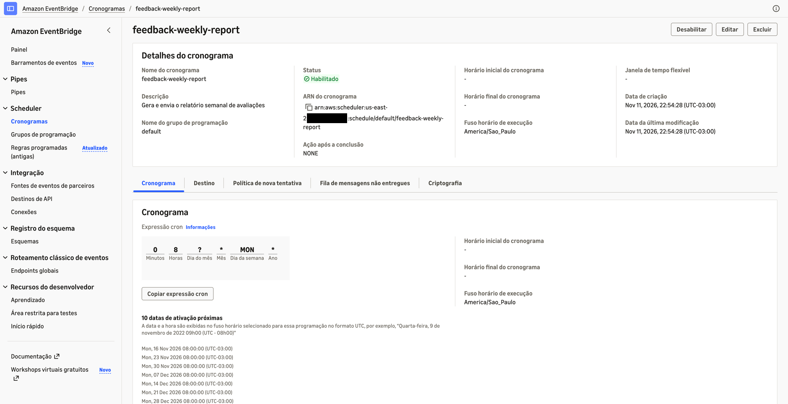

## 7. Revisão de acesso

Cada função tem o próprio papel IAM, com prefixo `feedback-`, e a agenda também (`feedback-scheduler`). Os papéis `github-*` são os do CI (ver [segurança](../seguranca.md)); os demais são gerenciados pela AWS.

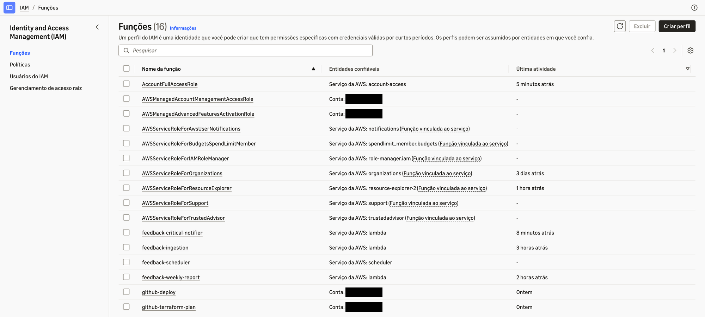

O que cada papel pode fazer está nas políticas do Terraform (`infra/envs/dev/main.tf`):

| Papel | Permissões |
|---|---|
| `feedback-ingestion` | `dynamodb:PutItem` na tabela; `sqs:SendMessage` na fila de críticos |
| `feedback-critical-notifier` | Receber, apagar, ler atributos e mudar a visibilidade de mensagens da fila de críticos; `sns:Publish` só no tópico `feedbacks-criticos` |
| `feedback-weekly-report` | `dynamodb:Query` só no índice `por-dia`; `sns:Publish` só no tópico `relatorio-semanal` |
| `feedback-scheduler` | `lambda:InvokeFunction` só no alias `live` do `weekly-report` |

Todos também gravam logs só no próprio grupo do CloudWatch. A fila tem uma política própria que libera o envio só para a ingestão e o consumo só para o notifier, e nega qualquer acesso sem HTTPS.

### Limitações da conta simplificada

- **IAM Access Analyzer:** criar ou listar analisadores é negado por uma SCP gerenciada pela AWS (*explicit deny in a service control policy*), a mesma restrição que bloqueia o OIDC ([ADR 0004](../adr/0004-conta-aws-simplificada.md)). Por isso a revisão de acesso externo foi feita manualmente: o único recurso público é a Function URL da ingestão, que é o `POST /avaliacao` exigido no enunciado.

  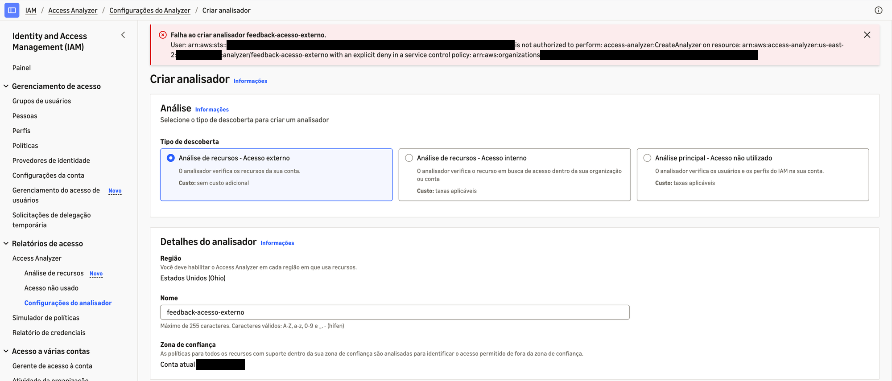

- **Simulador de políticas do IAM:** `aws iam simulate-principal-policy` responde `explicitDeny` para todas as ações, até para as que as funções executam de verdade nos testes acima (gravar na tabela, publicar na fila e no tópico). Como as políticas dos papéis não têm nenhuma regra de negação, o `explicitDeny` vem da SCP da conta, que o simulador avalia sem o contexto real da chamada. Por isso o resultado não serve para validar os papéis.
