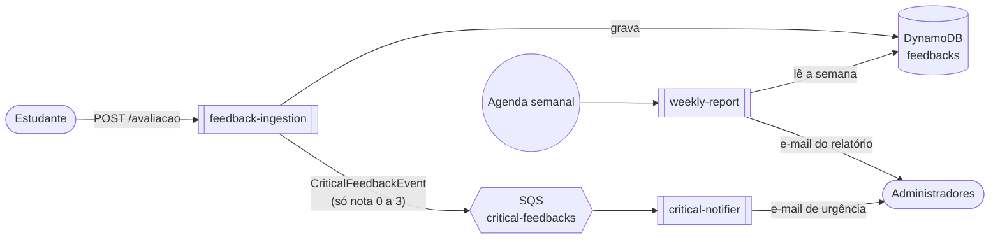

# Funções serverless

Visão geral das três funções da plataforma: o que cada uma faz, como são acionadas e como se ligam. O contrato, os exemplos e a configuração de cada função ficam no README dela; a arquitetura completa está em [`arquitetura.md`](arquitetura.md).

## As três funções

| Função | Responsabilidade única | Gatilho local | Gatilho na AWS | Documentação |
|---|---|---|---|---|
| `feedback-ingestion` | Receber, validar e gravar a avaliação; publicar as críticas | HTTP `POST /avaliacao` (porta 8081) | Lambda Function URL (`POST <url>avaliacao`) | [README](../functions/feedback-ingestion/README.md) |
| `critical-notifier` | Enviar o e-mail de urgência das avaliações críticas | HTTP `POST /notify-critical-feedback` (porta 8082) | Fila SQS `critical-feedbacks` | [README](../functions/critical-notifier/README.md) |
| `weekly-report` | Consolidar a semana e enviar o relatório | HTTP `POST /generate-weekly-report` (porta 8083) | EventBridge Scheduler, segunda às 08:00 (São Paulo) | [README](../functions/weekly-report/README.md) |

Cada função tem um único motivo para mudar: o contrato da API e a classificação (ingestion), o canal e o formato do alerta (notifier), o conteúdo e a periodicidade do relatório (report). O porquê da separação está na [arquitetura](arquitetura.md#4-por-que-três-funções-e-uma-fila).

## Como se ligam

As funções não se chamam diretamente. Elas se comunicam por dois contratos:

| Contrato | Entre | Formato |
|---|---|---|
| `CriticalFeedbackEvent` | ingestion → notifier, pela fila | JSON com `id`, `description`, `rating`, `urgency` e `createdAt` ([exemplo](../functions/critical-notifier/README.md#entrada-criticalfeedbackevent)) |
| Item da tabela `feedbacks` | ingestion grava → report lê | Atributos `id`, `description`, `rating`, `urgency`, `createdAt` e `createdDay` ([detalhes](../functions/feedback-ingestion/README.md#build-para-a-aws)) |

O notifier e o report reconstroem o `Feedback` do domínio a partir desses dados e reaplicam as regras. Um evento inválido nunca vira e-mail: a mensagem vai para a DLQ.

## Regra de urgência

A urgência é calculada pela nota no domínio compartilhado (`Urgency.fromRating`, em `shared/feedback-domain`), igual nas três funções:

| Nota | Urgência | Crítica | Efeito |
|---|---|---|---|
| 0 a 3 | `HIGH` | sim | Gravada, publicada na fila e enviada por e-mail aos administradores |
| 4 a 6 | `MEDIUM` | não | Gravada; aparece no relatório semanal |
| 7 a 10 | `LOW` | não | Gravada; aparece no relatório semanal |

Nota fora de 0 a 10 é rejeitada com `400`.

## O que as três têm em comum

| Item | Como é |
|---|---|
| Stack | Java 21, Quarkus 3.40.1, Clean Architecture (`domain`, `application`, `infra`) |
| Build local | Servidor HTTP com gateways provisórios (memória e log): dev mode, Docker e testes sem AWS |
| Build da AWS | `mvn package -Plambda` gera o `function.zip` com os gateways reais (DynamoDB, SQS e SNS) e o handler da Lambda |
| Lambda | Java 21, 512 MB, SnapStart, alias `live`; papel IAM próprio com prefixo `feedback-` |
| Logs | Um grupo no CloudWatch por função, retenção de 7 dias; as linhas levam o id do feedback quando ele existe |
| Monitoramento | Dashboard `feedback-plataforma`, alarme de erros por função e consultas salvas no Logs Insights ([infra](../infra/README.md#monitoramento)) |
| Imagem Docker | `ghcr.io/john-duque/12adjt-fase-4/<função>` |
| Testes | `mvn -pl functions/<função> -am verify` (JUnit, AssertJ e `@QuarkusTest`) |

## Evidências na nuvem

O teste ponta a ponta das três funções na AWS, com as respostas, os e-mails, a DLQ e o relatório, está em [`evidencias/teste-ponta-a-ponta.md`](evidencias/teste-ponta-a-ponta.md).
