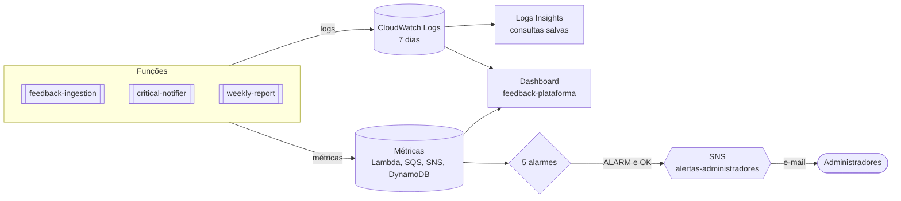
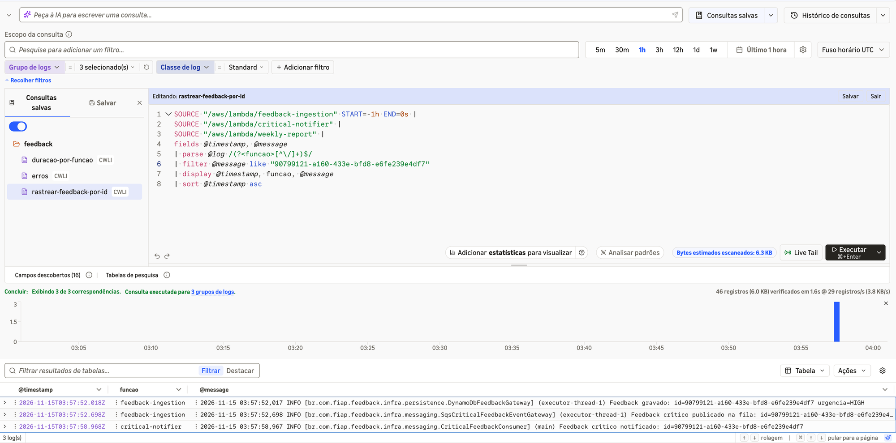
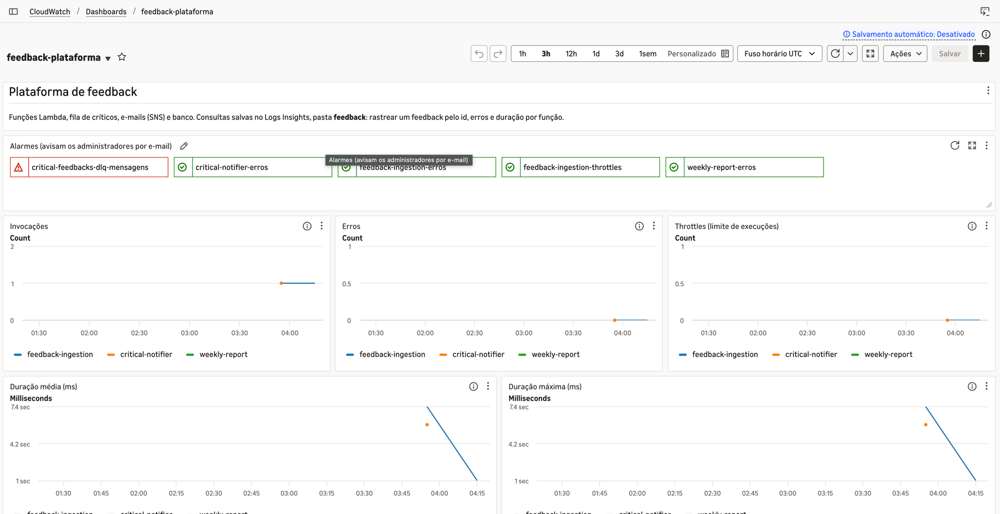
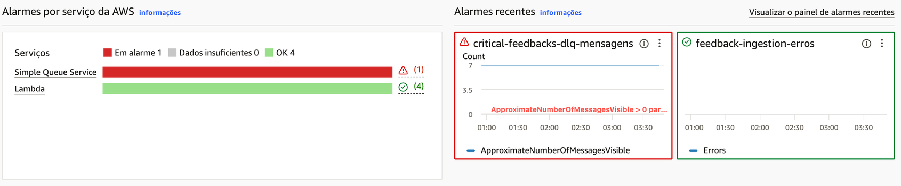
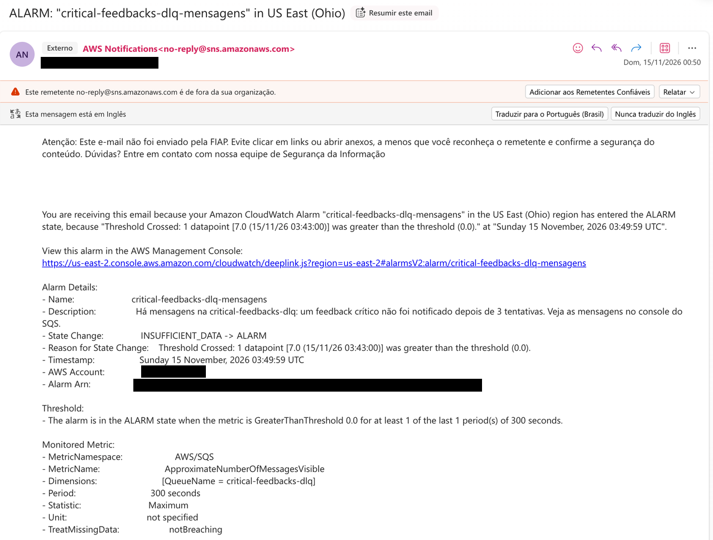
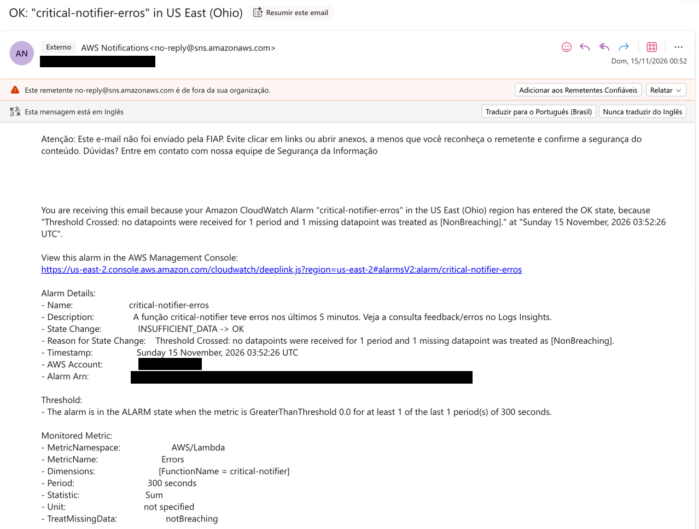

# Monitoramento

Como a plataforma é acompanhada na AWS: o que fica registrado nos logs, quais métricas aparecem no dashboard, como rastrear uma avaliação de ponta a ponta e quais alarmes avisam os administradores por e-mail. Tudo é criado pelo Terraform (módulo [`infra/modules/monitoring`](../infra/modules/monitoring)) e usa só o que o CloudWatch oferece sem custo.

## Visão geral



| Peça | Recurso na AWS | Para quê |
|---|---|---|
| Logs | Um grupo `/aws/lambda/<função>` por função, retenção de 7 dias | Ver o que cada execução fez, com o id do feedback |
| Consultas | 3 consultas salvas no Logs Insights, pasta `feedback` | Rastrear uma avaliação, listar erros e medir a duração |
| Dashboard | `feedback-plataforma` | Ver a saúde de toda a plataforma numa tela |
| Alarmes | 5 alarmes do CloudWatch | Avisar quando algo crítico falhar |
| Notificação | Tópico SNS `alertas-administradores` com assinatura por e-mail | Levar o alarme até os administradores |

## 1. Logs

Cada função grava no próprio grupo de logs, criado pelo Terraform com **retenção de 7 dias** (o padrão da Lambda é nunca apagar). O papel de cada função só pode gravar no seu grupo ([segurança](seguranca.md#6-papéis-das-funções-lambda)).

Nível `INFO` para tudo e `DEBUG` para o pacote do projeto (`br.com.fiap.feedback`). As linhas que importam para acompanhar uma avaliação levam o **id do feedback**:

| Função | Log | Quando |
|---|---|---|
| `feedback-ingestion` | `Feedback gravado: id=... urgencia=...` | Toda avaliação gravada no DynamoDB |
| `feedback-ingestion` | `Feedback crítico publicado na fila: id=...` | Avaliação com nota 0 a 3 |
| `feedback-ingestion` | `Falha ao publicar feedback crítico na fila: id=...` | Erro no SQS (a requisição responde 500) |
| `critical-notifier` | `Feedback crítico notificado: id=...` | E-mail de urgência enviado |
| `critical-notifier` | `Falha ao notificar feedback crítico: id=...` | Erro no envio; a mensagem volta para a fila |
| `weekly-report` | `Relatório semanal enviado: periodo=... total=... media=...` | Relatório entregue |

A descrição da avaliação, que é o texto do estudante, **não** vai para os logs da AWS: fica só no banco e nos e-mails.

Além disso, a Lambda grava uma linha `REPORT` no fim de cada execução, com duração, memória usada e, quando houver, o tempo de restauração do SnapStart.

## 2. Consultas salvas (Logs Insights)

CloudWatch → **Logs Insights** → **Consultas salvas** → pasta `feedback`. As três consultas leem os três grupos de logs e mostram só o nome da função (o caminho completo do grupo traz o ID da conta).

| Consulta | O que mostra |
|---|---|
| `rastrear-feedback-por-id` | Todas as linhas de um feedback, em ordem, em todas as funções. Troque `COLE-O-ID-DO-FEEDBACK-AQUI` pelo `id` devolvido no `POST /avaliacao` |
| `erros` | As 50 linhas mais recentes com `ERROR`, exceção ou timeout (`Task timed out`) nas três funções |
| `duracao-por-funcao` | Execuções, duração média e máxima e memória máxima por função, a partir das linhas `REPORT` |

Exemplo: uma avaliação com nota 2 passou pela ingestão (gravada e publicada na fila) e, 6 segundos depois, pelo notifier (e-mail enviado):



## 3. Dashboard

CloudWatch → **Painéis** → `feedback-plataforma` (a saída `dashboard_url` do Terraform tem o link direto). Os gráficos usam períodos de 5 minutos.

| Quadro | Métricas |
|---|---|
| Alarmes | Estado dos 5 alarmes, no topo |
| Invocações, Erros, Throttles | `Invocations`, `Errors` e `Throttles` das três funções |
| Duração média e máxima | `Duration` das três funções |
| Fila de críticos | Mensagens enviadas e processadas na `critical-feedbacks` |
| Mensagens esperando na fila | Mensagens visíveis e idade da mais antiga |
| DLQ | Mensagens na `critical-feedbacks-dlq`, como número: qualquer valor acima de 0 é um feedback crítico sem e-mail |
| E-mails (SNS) | Notificações entregues e com falha por tópico |
| Capacidade do DynamoDB | Escrita consumida na tabela (ingestão) e leitura no índice `por-dia` (relatório) |
| Erros recentes | Resultado da consulta `erros` (tabela) |



No print, o alarme da DLQ está em alarme por causa das mensagens inválidas enviadas de propósito no [teste ponta a ponta](evidencias/teste-ponta-a-ponta.md#5-evento-inválido-vai-para-a-dlq). Os gráficos mostram as chamadas do teste: duração alta na primeira chamada (restauração do SnapStart) e queda nas seguintes.

## 4. Alarmes e notificação dos administradores

Cada alarme é avaliado a cada 5 minutos e manda e-mail pelo tópico `alertas-administradores` quando **entra em alarme** e quando **volta ao normal**. Sem dados no período (função parada) conta como normal (`treat_missing_data = notBreaching`).

| Alarme | Dispara quando | O que significa |
|---|---|---|
| `feedback-ingestion-erros` | `Errors` > 0 em 5 min | A ingestão falhou: o estudante recebeu 500 |
| `critical-notifier-erros` | `Errors` > 0 em 5 min | O notifier falhou na execução inteira (timeout, por exemplo) |
| `weekly-report-erros` | `Errors` > 0 em 5 min | O relatório não saiu; a agenda tenta mais 2 vezes |
| `critical-feedbacks-dlq-mensagens` | Mensagens visíveis na DLQ > 0 | Um feedback crítico falhou 3 vezes e o e-mail de urgência não saiu |
| `feedback-ingestion-throttles` | `Throttles` > 0 em 5 min | A URL recusou requisições (`429`) por falta de execuções simultâneas (limite de 10 da conta) |

O alarme da DLQ existe porque o alarme de erros do notifier não pega uma mensagem com falha: o notifier devolve só aquela mensagem para a fila e a execução termina sem erro.

O tópico `alertas-administradores` **não** usa criptografia com a chave `aws/sns`, porque o CloudWatch não consegue publicar num tópico criptografado com ela. As mensagens só têm o nome, o estado e a métrica do alarme, nenhum dado de avaliação.



E-mail recebido quando o alarme da DLQ disparou:



E-mail de volta ao normal (`OK`):



### Como testar um alarme

No CloudShell, force o estado de alarme. Na próxima avaliação, em até 5 minutos, ele volta sozinho para `OK`, e chegam os dois e-mails:

```bash
aws cloudwatch set-alarm-state --alarm-name feedback-ingestion-erros --state-value ALARM --state-reason "Teste do alarme"
```

### O que fazer quando um alarme disparar

| Alarme | Primeiro passo |
|---|---|
| `*-erros` | Rodar a consulta `feedback/erros` e ver a exceção |
| `critical-feedbacks-dlq-mensagens` | SQS → `critical-feedbacks-dlq` → **Enviar e receber mensagens** → **Pesquisar mensagens**. Corrigir a causa e devolver as mensagens com **Iniciar redirecionamento da DLQ**, ou limpar a DLQ se forem inválidas. Enquanto houver mensagens, o alarme continua em `ALARM` (o e-mail sai só quando o estado muda) |
| `feedback-ingestion-throttles` | Ver no dashboard se foi pico real ou abuso; o limite da conta segura o custo |

## 5. Assinatura dos e-mails

Os e-mails dos administradores vêm do secret `ADMIN_EMAILS` do GitHub, o mesmo dos tópicos de urgência e de relatório. Depois do primeiro deploy, cada administrador recebe um e-mail **AWS Notification - Subscription Confirmation** e precisa clicar em **Confirm subscription** ([deploy](deploy.md#31-automático-o-caminho-normal)). Para incluir um administrador, basta acrescentar um apelido e um e-mail no secret e rodar o deploy.

## 6. Custo

| Item | Limite sempre gratuito | Uso |
|---|---|---|
| Dashboard | 3 dashboards de até 50 métricas | 1 dashboard, 26 métricas |
| Alarmes | 10 alarmes de métrica padrão | 5 |
| Logs (ingestão, armazenamento e Logs Insights) | 5 GB por mês | Poucos MB (retenção de 7 dias) |
| Consultas salvas | Sem custo | 3 |
| E-mails do SNS | 1.000 por mês | Só nas mudanças de estado dos alarmes |
