# Segurança e governança de acesso

Como a conta AWS do projeto é protegida: quem acessa, com que permissão, como o CI faz deploy sem permissão direta e como tudo é auditado.

> **Rascunho (T30).** Esta versão cobre a conta, o acesso e as credenciais do CI. Criptografia, parâmetros e proteção da API entram na versão final (T48).

Decisões relacionadas: [ADR 0002](adr/0002-provedor-de-nuvem.md) (AWS e serviços sempre gratuitos) e [ADR 0004](adr/0004-conta-aws-simplificada.md) (conta simplificada, região `us-east-2` e CI sem OIDC).

## Resumo

| Controle | Como é feito |
|---|---|
| Acesso humano | AWS Builder ID com MFA em dois dispositivos; sem usuário raiz |
| Privilégio mínimo do CI | Dois usuários técnicos, cada um só pode assumir um papel |
| Credenciais temporárias | O CI recebe credenciais de 1 h ao assumir o papel |
| Privilégio mínimo das funções | Um papel IAM por função Lambda, só com o que ela usa |
| Custo | Plano gratuito, sem cobrança; só serviços sempre gratuitos |
| Auditoria | Histórico de eventos do CloudTrail (90 dias, gratuito) |

## 1. Conta e plano

| Item | Valor |
|---|---|
| Cadastro | Simplificado (*Sign up for AWS (new)*), um projeto numa organização gerenciada pela AWS |
| Plano | Gratuito: US$ 100 de créditos, sem cobranças enquanto não houver upgrade |
| Criação | 09/11/2026 |
| Fim do plano gratuito | **09/05/2027** |
| Região | `us-east-2` (Ohio), fixa no projeto |

A entrega é em 17/11/2026 e a avaliação leva de 3 a 4 meses, então o plano gratuito cobre todo o período. Se a avaliação passar de 09/05/2027, é preciso fazer upgrade antes dessa data (os serviços sempre gratuitos continuam sem custo).

Dois botões ficam **proibidos** no painel: **Atualizar** (upgrade para o plano pago) e **Continue com a ativação** (recursos avançados). Os dois são irreversíveis (ver ADR 0004).

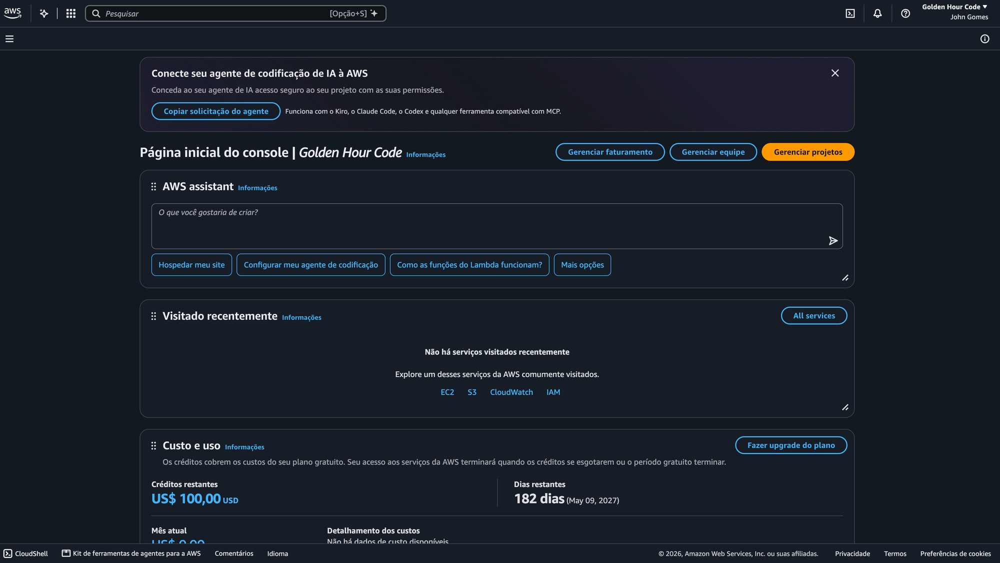

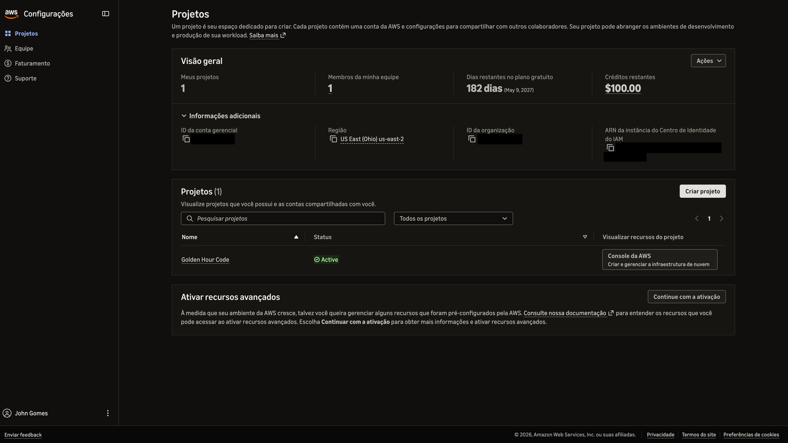

## 2. Acesso humano

- **Dono da conta**: AWS Builder ID. Não existe usuário raiz nesse tipo de cadastro. O console entra por um papel gerenciado pela AWS, com sessão temporária.
- **MFA**: dois dispositivos registrados, uma *passkey* (WebAuthn) e um app autenticador (TOTP). Se um se perder, o outro mantém o acesso.
- **E-mail de recuperação**: diferente do e-mail de login.
- **Sem chave de acesso pessoal**: quando é preciso usar a AWS CLI, o acesso é pelo **CloudShell**, que usa a sessão do console.
- **Usuários IAM só para programas**: a própria AWS avisa que, nesse cadastro, usuários IAM são só para acesso programático. Os únicos usuários IAM são os dois do CI (seção 5).

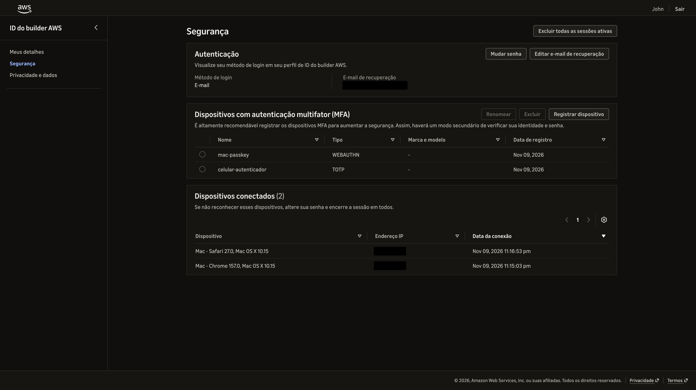

### Integrantes

Hoje o projeto tem **um integrante**, que é o dono da conta. Para incluir alguém:

1. **Configurações → Equipe → Convidar novo membro**, com o e-mail da pessoa.
2. A pessoa cria o próprio AWS Builder ID e registra MFA nele.
3. O membro tem acesso de administrador aos recursos do projeto, mas **não** vê nem altera faturamento, não convida nem remove pessoas e não faz upgrade.

Nenhuma credencial é compartilhada: cada pessoa entra com o próprio Builder ID.

## 3. Custo

- O plano gratuito **não gera cobrança**: o painel de faturamento mostra "Sem cobranças enquanto estiver no plano gratuito".
- Só o dono pode fazer upgrade; membros da equipe não podem.
- A arquitetura usa só serviços **sempre gratuitos** (ADR 0002). API Gateway, SES, Secrets Manager, chave KMS própria, trilha do CloudTrail, NAT Gateway e bucket S3 ficam de fora.
- O AWS Budgets não está disponível nesse cadastro; os créditos e os dias restantes aparecem no painel de faturamento.

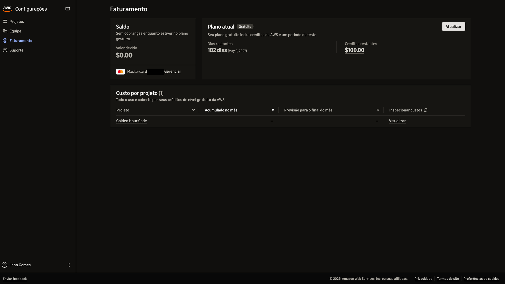

## 4. Auditoria

O **histórico de eventos do CloudTrail** guarda 90 dias de eventos de gerenciamento, sem custo e sem criar trilha.

- Eventos regionais (Lambda, DynamoDB, SQS, `AssumeRole`…) aparecem em `us-east-2`.
- Eventos do IAM, que é global, aparecem em `us-east-1` (Norte da Virgínia).

O print mostra a configuração da T30 em ordem: a tentativa de criar o provedor OIDC (negada), a criação dos usuários e papéis, as políticas, e a chave de teste criada e apagada. Até a tentativa com a política malformada ficou registrada.

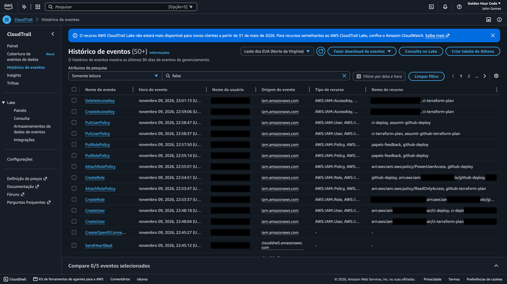

## 5. Credenciais do CI (GitHub Actions)

### Por que não OIDC

O plano original (ADR 0003) era o GitHub Actions assumir um papel via OIDC, sem nenhuma chave. Nesta conta, a política da organização, gerenciada pela AWS, **bloqueia a criação do provedor OIDC**:

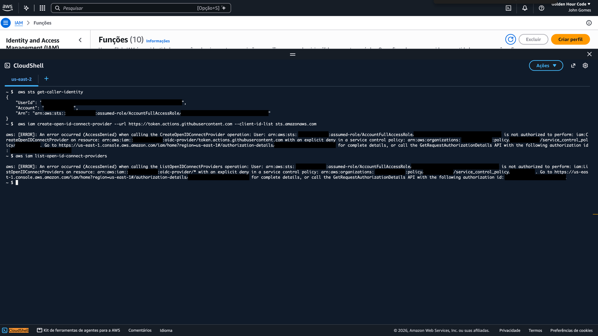

### Desenho

Dois usuários técnicos, sem console, cada um só pode assumir **um** papel:

| Usuário IAM | Política do usuário | Papel | Permissões do papel | Chave guardada em |
|---|---|---|---|---|
| `ci-terraform-plan` | `sts:AssumeRole` só em `github-terraform-plan` | `github-terraform-plan` | `ReadOnlyAccess` | Secret do repositório (`plan` nos PRs) |
| `ci-deploy` | `sts:AssumeRole` só em `github-deploy` | `github-deploy` | `PowerUserAccess` + `papeis-feedback` | Secret do Environment `production` (só a `main`) |

Cada papel confia **só no seu usuário** (política de confiança com o ARN do usuário).

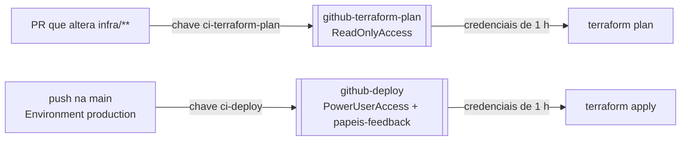

A política `papeis-feedback` deixa o papel de deploy criar, alterar, apagar e passar (`iam:PassRole`) **só papéis com nome `feedback-*`**: os das funções Lambda e o do agendador. Ele não consegue mexer em usuários, em políticas gerenciadas nem nos papéis do CI.

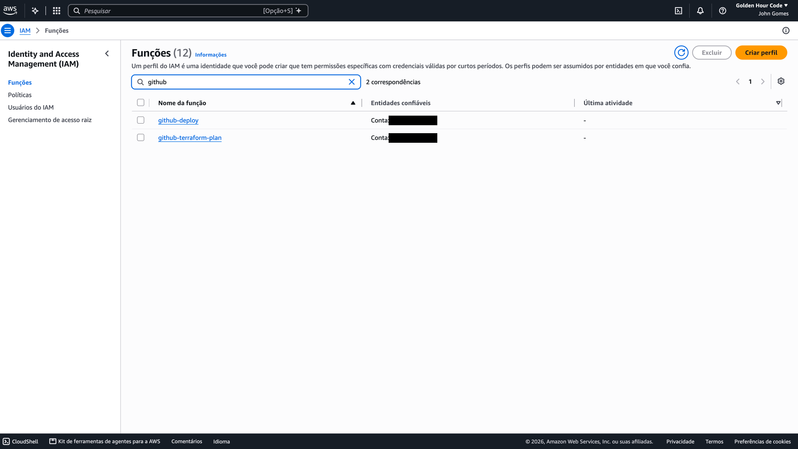

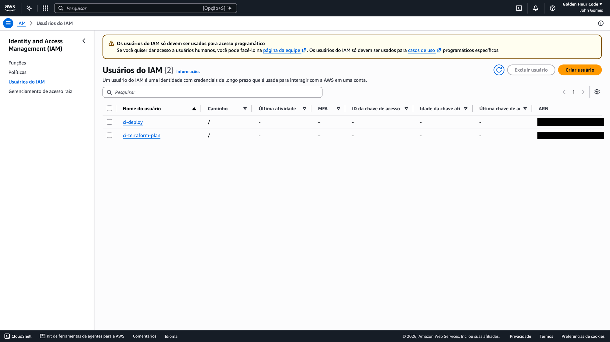

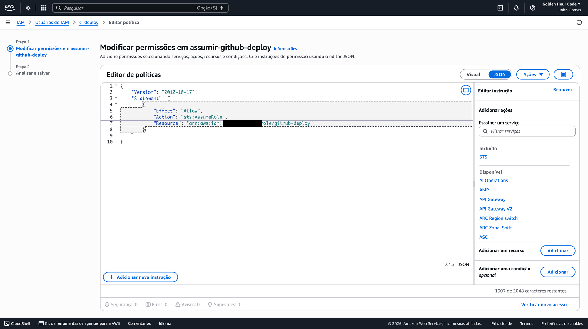

### Controles compensatórios

Como existe chave de longa duração, ela é limitada assim:

- **A chave sozinha não faz nada**: a única permissão do usuário é assumir o próprio papel.
- **PR não faz deploy**: a chave usada nos PRs só assume o papel de leitura.
- **Chaves criadas só quando o pipeline existir** (T42), direto nos secrets do GitHub, nunca no código. Hoje os dois usuários estão **sem nenhuma chave**.
- **Rotação**: a cada 90 dias, ou na hora se houver suspeita. Criar a chave nova, atualizar o secret, rodar o workflow e apagar a antiga.
- **Rastreio**: todo `AssumeRole` fica no CloudTrail, com o usuário que assumiu.

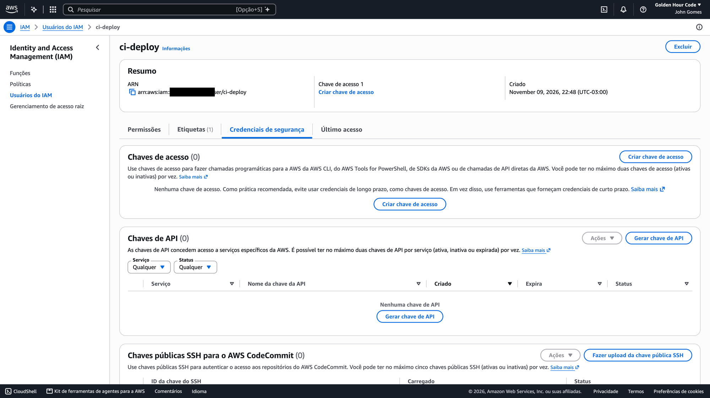

### Teste

Feito no CloudShell, com uma chave temporária do `ci-terraform-plan` apagada no fim:

| Tentativa | Resultado |
|---|---|
| `ci-terraform-plan` assume `github-terraform-plan` | ✅ `assumed-role/github-terraform-plan/teste` |
| `ci-terraform-plan` assume `github-deploy` | ✅ negado (`AccessDenied`) |

### Políticas

`<ACCOUNT_ID>` é o ID da conta do projeto.

Confiança do `github-deploy` (a do `github-terraform-plan` é igual, com `ci-terraform-plan`):

```json
{
  "Version": "2012-10-17",
  "Statement": [
    {
      "Effect": "Allow",
      "Principal": { "AWS": "arn:aws:iam::<ACCOUNT_ID>:user/ci-deploy" },
      "Action": "sts:AssumeRole"
    }
  ]
}
```

Política do usuário `ci-deploy` (`assumir-github-deploy`):

```json
{
  "Version": "2012-10-17",
  "Statement": [
    {
      "Effect": "Allow",
      "Action": "sts:AssumeRole",
      "Resource": "arn:aws:iam::<ACCOUNT_ID>:role/github-deploy"
    }
  ]
}
```

Política `papeis-feedback` do papel `github-deploy`:

```json
{
  "Version": "2012-10-17",
  "Statement": [
    {
      "Sid": "SoPapeisDoProjeto",
      "Effect": "Allow",
      "Action": [
        "iam:CreateRole", "iam:DeleteRole", "iam:GetRole", "iam:UpdateRole",
        "iam:UpdateAssumeRolePolicy", "iam:TagRole", "iam:UntagRole", "iam:ListRoleTags",
        "iam:PutRolePolicy", "iam:GetRolePolicy", "iam:DeleteRolePolicy", "iam:ListRolePolicies",
        "iam:AttachRolePolicy", "iam:DetachRolePolicy", "iam:ListAttachedRolePolicies",
        "iam:ListInstanceProfilesForRole", "iam:PassRole"
      ],
      "Resource": "arn:aws:iam::<ACCOUNT_ID>:role/feedback-*"
    }
  ]
}
```

Esses usuários, papéis e políticas foram criados à mão no CloudShell, porque precisam existir antes de o Terraform rodar no CI. Todo o resto da infraestrutura é criado pelo Terraform.

## 6. Papéis das funções Lambda

Cada função tem o próprio papel IAM, criado pelo Terraform (prefixo `feedback-`), com `AWSLambdaBasicExecutionRole` para gravar logs e só o mínimo além disso:

| Função | Pode | Não pode |
|---|---|---|
| `feedback-ingestion` | `dynamodb:PutItem` na tabela `feedbacks`; `sqs:SendMessage` na fila `critical-feedbacks` | Ler o banco, enviar e-mail |
| `critical-notifier` | `sqs:ReceiveMessage`, `sqs:DeleteMessage` e `sqs:GetQueueAttributes` na fila; `sns:Publish` no tópico `feedbacks-criticos` | Acessar o banco |
| `weekly-report` | `dynamodb:Query` na tabela e no índice `por-dia`; `sns:Publish` no tópico `relatorio-semanal` | Gravar no banco, acessar a fila |

O EventBridge Scheduler também tem um papel `feedback-*`, só com `lambda:InvokeFunction` na `weekly-report`.

## 7. Próximos passos

- **T35**: criptografia (chaves gerenciadas pela AWS), parâmetros de configuração e limite de requisições da Function URL (*reserved concurrency*).
- **T42**: criar as chaves dos usuários do CI, os secrets e o Environment `production` com *Deployment branches* só na `main`.
- **T48**: versão final deste documento.
